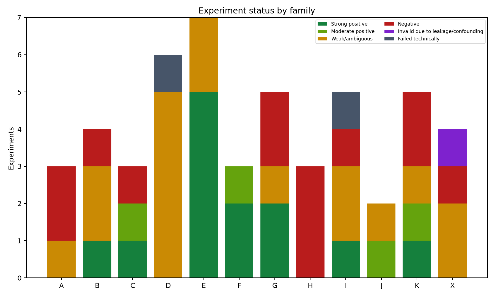
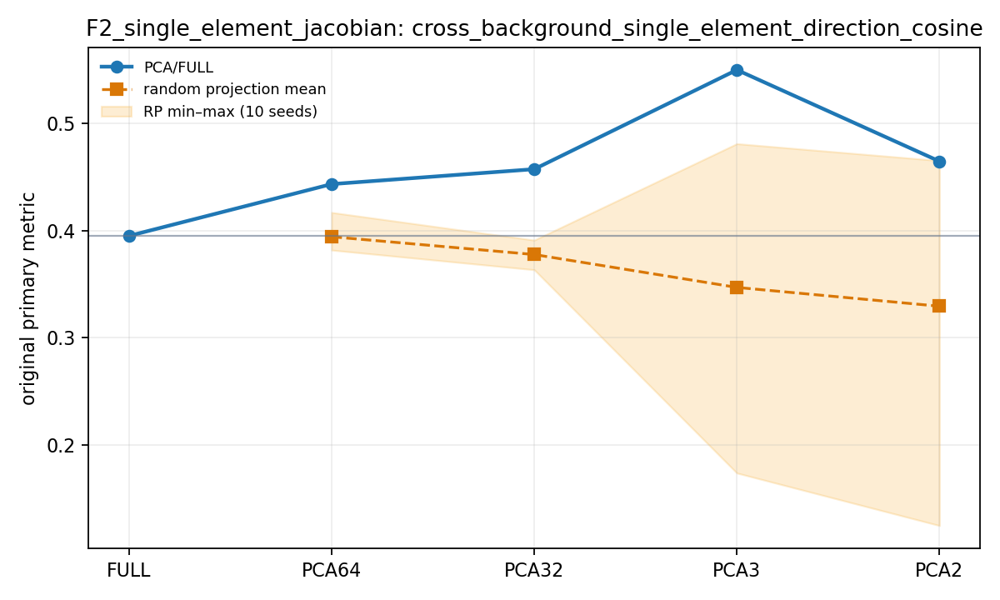
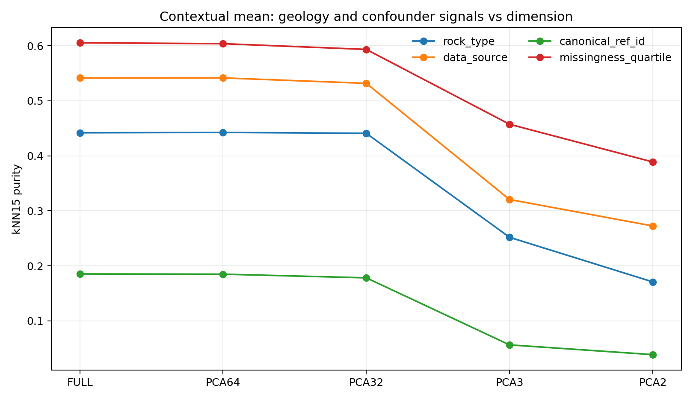
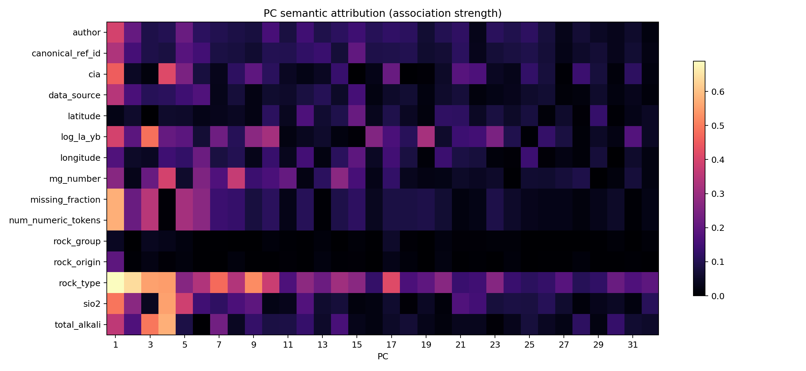

# Element2Vec Geochemistry Experiments

Element2Vec is a staged research project about how geochemical measurements can be encoded as tokens and whether the resulting token and sample-latent spaces contain interpretable geological structure. This repository publishes the current experimental snapshot, the code needed to reproduce it when the original datasets are supplied, compact result tables and figures, and the trained Element2Vec V2 checkpoints.

> **Research snapshot — no license granted.** This repository is publicly visible for scientific communication and personal continuity. It has no open-source license. Public access does not grant permission to use, copy, modify, redistribute, sublicense, commercialize, or incorporate the code or model weights into another project. See [RIGHTS.md](RIGHTS.md).

## Current result in one paragraph

Element2Vec V2 clearly contextualizes individual chemical tokens: the same element value changes representation with the rest of the sample, and controlled perturbations produce partly stable local directions. It does **not** yet support a claim that the entire embedding space is a universal geochemical semantic system. Static element-tag embeddings show weak periodic and broad geochemical organization; source, publication, analytical panel, and missingness are strong confounders; sample-to-label alignment is weak; and many visually smooth process trajectories are also expected from a continuous neural network. A multiscale PCA replay found one strict low-rank recovery: the single-element finite-difference/Jacobian experiment improved in PCA64 and PCA32 relative to both the full space and matched random projections. The evidence therefore favors local, representation-specific low-rank structure rather than one universal 32D or 64D geological space.

The detailed state of every stage is in [EXPERIMENT_STATUS.md](EXPERIMENT_STATUS.md). The main Stage 3.6 reports are:

- [Breadth-first representation-space report](stage3_6_element2vec_space_exploration/reports/element2vec_exploration_report.md)
- [Multiscale PCA subspace report](stage3_6_element2vec_space_exploration/subspace_audit/reports/subspace_exploration_report.md)
- [Experiment × dimension matrix](stage3_6_element2vec_space_exploration/subspace_audit/reports/experiment_dimension_matrix.csv)

## Representative results

These figures summarize the current evidence; they are not standalone proof. The linked reports define the metrics, baselines, bootstrap procedures, and confounder controls.

### Breadth-first audit: positive and negative outcomes were both retained



The original experiment registry preserves weak, negative, confounded, and technically failed results alongside positive ones. Idealized process trajectories account for many positive outcomes, while static element semantics and sample–label alignment remain much less convincing. A status here describes a prespecified experiment metric, not geological generalization by itself.

### Clearest low-rank recovery: single-element perturbation directions



The single-element finite-difference/Jacobian experiment is the one strict low-rank recovery in the current replay: PCA64 and PCA32 improve direction consistency relative to both FULL and matched random projections, with bootstrap support. The PCA3/PCA2 values should not be interpreted alone because very small random projections have broad, projection-sensitive ranges.

### Compression removes nuisance signal and geological signal together



Source, reference, and missingness neighborhood structure generally weaken under aggressive compression, but rock-type structure also weakens. This argues against treating PCA2/PCA3 as a clean geological space: dimensionality reduction changes the balance of signals rather than simply deleting nuisance structure.

### Principal components mix geology, chemistry, and acquisition history



The leading contextual-mean PCs respond to overlapping geological, compositional, source, missingness, and token-count variables. The mixed attribution motivates nuisance-aware evaluation and held-out source tests instead of assigning a single geological meaning to each dominant axis.

## Repository map

```text
pyrite_benchmark/                       Stage 1: pyrite preprocessing and baselines
stage2_geo_representation_xgb/          Stage 2: geology-informed features and probes
stage3_element_token_model/             Stage 3: small pyrite token-Transformer prototype
stage3_5_element2vec_v2/                Element2Vec V2 whole-rock model and training
stage3_6_element2vec_space_exploration/ Token/latent audits and multiscale subspaces
legacy_whole_rock_geochem/              Database-view helper; database is not included
docs/                                   Setup, history, checkpoints, reproducibility
scripts/                                Bootstrap and public-tree verification utilities
```

Stages communicate through files and do not form a Python package. Run commands from the repository root so the relative paths in the configs remain valid.

## Data policy

No dataset is included. In particular, the repository excludes:

- the whole-rock SQLite database;
- the raw pyrite workbook;
- processed sample tables;
- sample-level embeddings, latents, coordinates, caches, PCA fitting pools, and projection models.

The included CSV files are compact vocabularies, model-derived static embeddings, training logs, aggregate metrics, or experiment registries. Dataset placement and expected paths are documented in [docs/DATASET_SETUP.md](docs/DATASET_SETUP.md).

## Quick start on another computer

```bash
git clone https://github.com/plHXeF/element2vec-geochem-experiments.git
cd element2vec-geochem-experiments

conda env create -f environment.yml
conda activate element2vec-geochem

./scripts/fetch_checkpoints.sh
python scripts/doctor.py
```

Then supply one or both private datasets at their expected paths:

```text
legacy_whole_rock_geochem/geochem.db
pyrite_benchmark/data/raw/pyrite.xlsx
```

If only the V2/Stage 3.6 line is needed, only `geochem.db` is required. The released checkpoint can be inspected and used immediately after download; recomputing sample latents or experiments also requires the database.

## Reproduce the Element2Vec V2 line

Build the vocabulary and transformation statistics:

```bash
python -m stage3_5_element2vec_v2.src.data.build_vocab \
  --config stage3_5_element2vec_v2/configs/v2_base.yaml
```

Run a two-step smoke test before a long training run:

```bash
python -m stage3_5_element2vec_v2.src.training.train_v2 \
  --config stage3_5_element2vec_v2/configs/v2_base.yaml \
  --max-samples 256 --max-steps 2
```

Extract Stage 3.6 caches and replay the registered analyses:

```bash
python -m stage3_6_element2vec_space_exploration.src.audit_project \
  --config stage3_6_element2vec_space_exploration/configs/exploration.yaml
python -m stage3_6_element2vec_space_exploration.src.extract_cache \
  --config stage3_6_element2vec_space_exploration/configs/exploration.yaml
python -m stage3_6_element2vec_space_exploration.src.run_experiments \
  --config stage3_6_element2vec_space_exploration/configs/exploration.yaml
python -m stage3_6_element2vec_space_exploration.src.build_reports \
  --config stage3_6_element2vec_space_exploration/configs/exploration.yaml
python -m stage3_6_element2vec_space_exploration.src.verify_outputs \
  --config stage3_6_element2vec_space_exploration/configs/exploration.yaml
```

For the strict FULL/PCA64/PCA32/PCA3/PCA2 replay with random-projection controls:

```bash
python -m stage3_6_element2vec_space_exploration.src.run_subspace_replay \
  --config stage3_6_element2vec_space_exploration/configs/subspace_audit.yaml
python -m stage3_6_element2vec_space_exploration.src.build_subspace_report \
  --config stage3_6_element2vec_space_exploration/configs/subspace_audit.yaml
python -m stage3_6_element2vec_space_exploration.src.verify_subspace_audit \
  --config stage3_6_element2vec_space_exploration/configs/subspace_audit.yaml
```

Long training is intentionally not hidden behind a one-command bootstrap. Monitor hardware memory, learning curves, probe loss, and checkpoint writes. See [docs/REPRODUCIBILITY.md](docs/REPRODUCIBILITY.md).

## Checkpoints

The small Stage 3 prototype checkpoint is stored directly in the repository. The four Element2Vec V2 files are distributed through GitHub Release assets; the two large files are split into ordered 64 MiB parts for transfer reliability. `scripts/fetch_checkpoints.sh` downloads/reassembles them into the exact path expected by the configs and verifies SHA-256 checksums. See [docs/CHECKPOINTS.md](docs/CHECKPOINTS.md).

## Known limitations

- V2 was trained on the full current dataset with geology labels among its objectives. Label readability is not held-out generalization.
- Publication/source and missing analytical panels remain strong, sometimes dominant, latent structure.
- Random 30% token dropout severely changes the latent even though token order is invariant.
- Static tag vocabularies are small: the numeric-tag PCA has at most rank 34, and only four trained REE tags are available.
- Strict CIPW normative mineralogy is not implemented. Existing I-series outputs use an explicitly labeled NNLS proxy.
- Several ideal process paths are geometry stress tests, not validated petrological forward models.
- The current checkpoint set contains only the final training state and same-step component exports, so checkpoint-sensitivity analysis is unavailable.
- Cross-machine determinism is not guaranteed across PyTorch versions and CPU/CUDA/MPS backends.

## For agents and future maintainers

Read [AGENTS.md](AGENTS.md) before changing or rerunning the project. It records the data boundary, stage dependencies, interpretation constraints, authoritative reports, and safe continuation workflow.

## Citation and contact

This is a personal, staged experiment by `plHXeF`, not a stable library or a peer-reviewed software release. For permission or collaboration requests, contact the author through the [GitHub profile](https://github.com/plHXeF) or send a direct message through a social profile linked there.
