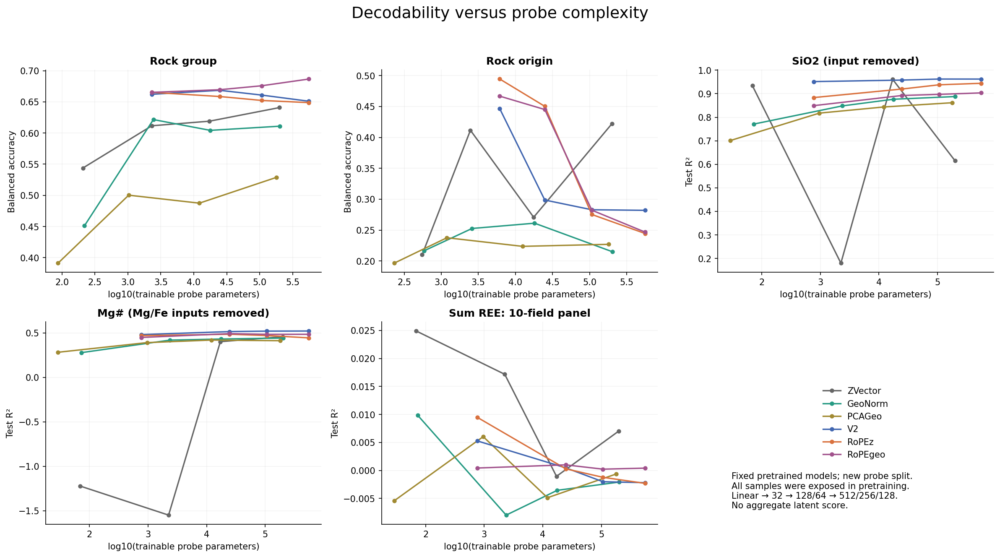
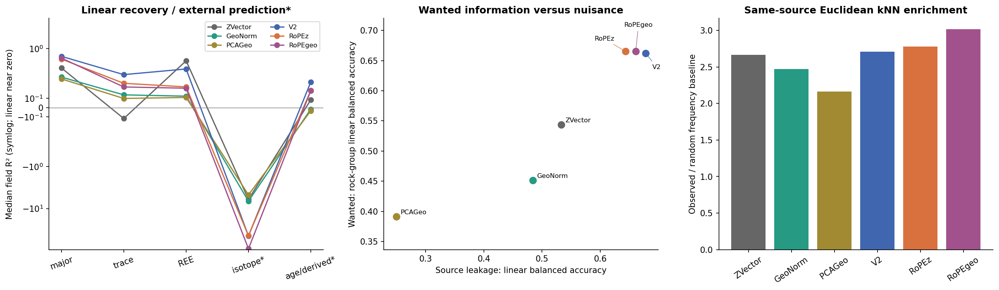
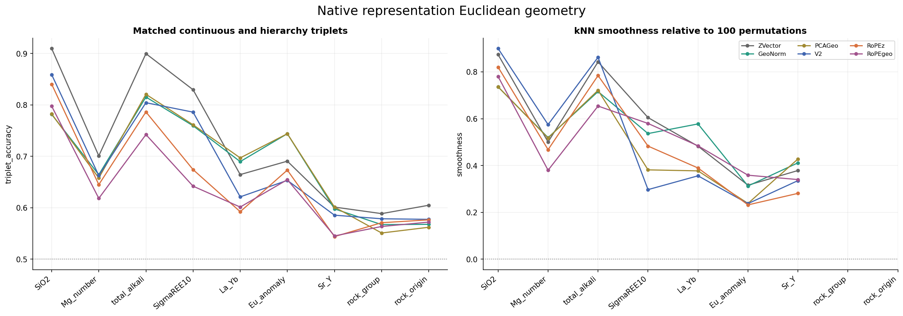
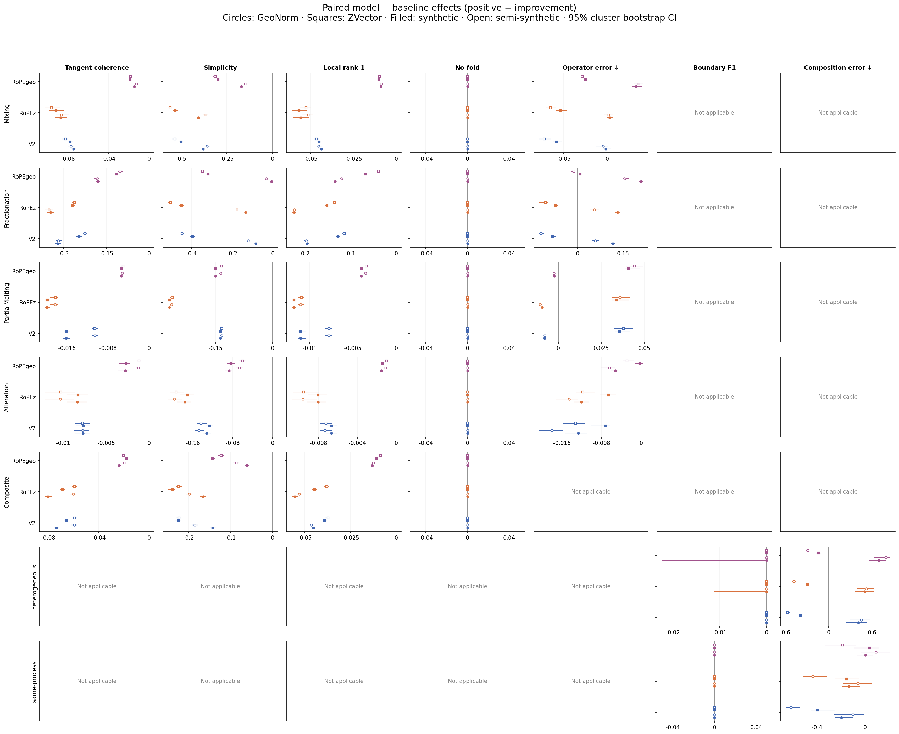
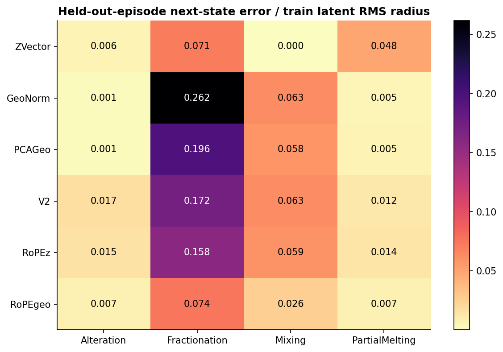
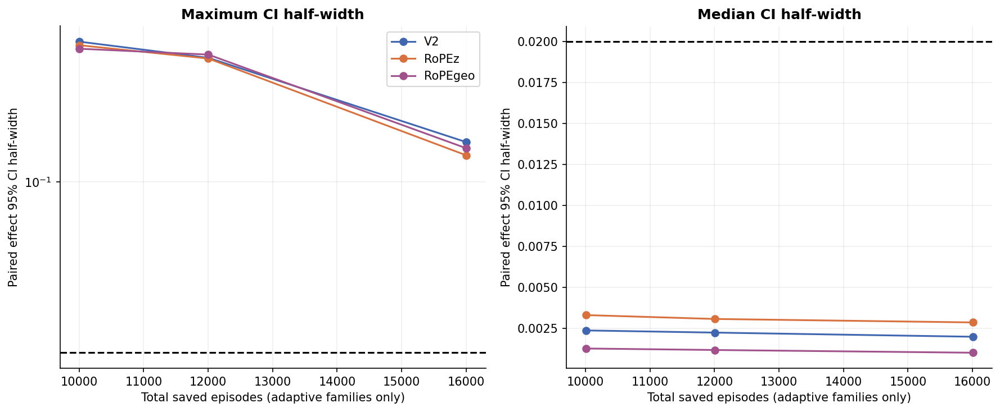

# Latent Evaluation Benchmark v0.1

本报告不计算人为加权总分。所有结果比较固定模型如何重组化学信息，以及这种重组的代价。

## Scope and provenance

真实记录 12,000；split 为 sample-ID hash 70/15/15。过程库每种单过程 2,000 条（synthetic / semi-synthetic 各半），另有 8,000 条 composite 和 4 条矿物固溶体校准。原三个模型没有重训、没有改写。

三个模型都在全量样品及岩石标签上预训练。所有真实数据得分是 fixed-representation decodability / geometry，不能当作未见文献或地区泛化。样品随机划分保留来源重叠，便于测量 nuisance；完整文献分组外推不是本轮结论。

## 1. Decodability

所有 label token 始终移除。SiO2 在任何模型/基线预处理前删除 sio2；Mg# 删除 mgo/feo/fe2o3；ΣREE 删除全部 REE 输入。目标遮盖后才计算闭合、CLR 和 RoPE_geo 坐标。Mg# 定义为 100 mol(MgO)/(mol(MgO)+mol(FeO))，不假设 ferric iron 全部为 Fe2+。ΣREE10 是数据库中 10 个 REE 的完整面板之和，不冒充全 14 元素总量。

四档 probe 使用 GELU（隐层）、AdamW、相同两个学习率预算和 early stopping。参数量含偏置，曲线横轴是真实参数量。AUC 的参数区间因输入维度不同，不能替代原始曲线。

### rock_group: balanced_accuracy

| representation | Linear | MLP128_64 | MLP32 | MLP512_256_128 |
| --- | --- | --- | --- | --- |
| ZVector | 0.5438 | 0.6190 | 0.6116 | 0.6408 |
| GeoNorm | 0.4513 | 0.6043 | 0.6216 | 0.6110 |
| PCAGeo | 0.3912 | 0.4875 | 0.5003 | 0.5288 |
| V2 | 0.6622 | 0.6609 | 0.6685 | 0.6510 |
| RoPEz | 0.6653 | 0.6523 | 0.6586 | 0.6488 |
| RoPEgeo | 0.6653 | 0.6758 | 0.6695 | 0.6866 |

### rock_origin: balanced_accuracy

| representation | Linear | MLP128_64 | MLP32 | MLP512_256_128 |
| --- | --- | --- | --- | --- |
| ZVector | 0.2101 | 0.2708 | 0.4115 | 0.4222 |
| GeoNorm | 0.2164 | 0.2611 | 0.2526 | 0.2150 |
| PCAGeo | 0.1965 | 0.2237 | 0.2376 | 0.2270 |
| V2 | 0.4463 | 0.2829 | 0.2986 | 0.2819 |
| RoPEz | 0.4944 | 0.2752 | 0.4502 | 0.2445 |
| RoPEgeo | 0.4667 | 0.2822 | 0.4450 | 0.2468 |

### SiO2: R2

| representation | Linear | MLP128_64 | MLP32 | MLP512_256_128 |
| --- | --- | --- | --- | --- |
| ZVector | 0.9340 | 0.9611 | 0.1801 | 0.6150 |
| GeoNorm | 0.7710 | 0.8765 | 0.8482 | 0.8879 |
| PCAGeo | 0.7011 | 0.8435 | 0.8175 | 0.8617 |
| V2 | 0.9514 | 0.9623 | 0.9579 | 0.9622 |
| RoPEz | 0.8836 | 0.9379 | 0.9198 | 0.9442 |
| RoPEgeo | 0.8492 | 0.8973 | 0.8924 | 0.9034 |

### Mg_number: R2

| representation | Linear | MLP128_64 | MLP32 | MLP512_256_128 |
| --- | --- | --- | --- | --- |
| ZVector | -1.2216 | 0.4014 | -1.5484 | 0.4571 |
| GeoNorm | 0.2783 | 0.4311 | 0.4188 | 0.4420 |
| PCAGeo | 0.2823 | 0.4195 | 0.3908 | 0.4123 |
| V2 | 0.4811 | 0.5200 | 0.5146 | 0.5212 |
| RoPEz | 0.4698 | 0.4704 | 0.4847 | 0.4442 |
| RoPEgeo | 0.4489 | 0.4835 | 0.4917 | 0.4839 |

### SigmaREE10: R2

| representation | Linear | MLP128_64 | MLP32 | MLP512_256_128 |
| --- | --- | --- | --- | --- |
| ZVector | 0.0249 | -0.0010 | 0.0172 | 0.0070 |
| GeoNorm | 0.0099 | -0.0035 | -0.0080 | -0.0021 |
| PCAGeo | -0.0054 | -0.0049 | 0.0060 | -0.0006 |
| V2 | 0.0053 | -0.0020 | 0.0005 | -0.0022 |
| RoPEz | 0.0095 | -0.0012 | 0.0003 | -0.0023 |
| RoPEgeo | 0.0004 | 0.0002 | 0.0010 | 0.0004 |

## 2. Information Sufficiency

真实 test 中共享同一随机 20% 数值字段遮盖；linear Ridge 仅从 masked-record 表示恢复原始值，超参数只看 val。isotope/age/derived 从未进入任何 encoder，因此这些组属于外部目标预测，不是对曾可见输入的字面重建。单字段支持数量与不可评估项均保存在表中；没有补造标签。

| representation | REE | age/derived | isotope | major | trace |
| --- | --- | --- | --- | --- | --- |
| ZVector | 0.5069 | 0.0830 | -6.0520 | 0.4252 | -0.1180 |
| GeoNorm | 0.1223 | -0.0175 | -6.6419 | 0.3269 | 0.1364 |
| PCAGeo | 0.1084 | -0.0346 | -4.7183 | 0.3076 | 0.0976 |
| V2 | 0.4147 | 0.2755 | -44.8920 | 0.6461 | 0.3537 |
| RoPEz | 0.2219 | 0.1837 | -44.4693 | 0.5568 | 0.2604 |
| RoPEgeo | 0.2078 | 0.1820 | -91.0313 | 0.5870 | 0.2210 |

来源/reference/missingness 用 linear AdamW probe。Reference 仅取 train 中至少 10 条的前 64 个文献；覆盖比例单列，不混同全词表分类。12 个 missingness cluster 仅在 train availability 上拟合。

| representation | target | balanced_accuracy | macro_F1 | coverage |
| --- | --- | --- | --- | --- |
| ZVector | data_source | 0.5331 | 0.5290 | 0.9351 |
| ZVector | canonical_ref_id | 0.5437 | 0.5023 | 0.4903 |
| ZVector | missingness_cluster | 0.9571 | 0.9587 | 1.0000 |
| GeoNorm | data_source | 0.4839 | 0.5039 | 0.9351 |
| GeoNorm | canonical_ref_id | 0.4632 | 0.4495 | 0.4903 |
| GeoNorm | missingness_cluster | 0.9515 | 0.9536 | 1.0000 |
| PCAGeo | data_source | 0.2495 | 0.2544 | 0.9351 |
| PCAGeo | canonical_ref_id | 0.1732 | 0.1590 | 0.4903 |
| PCAGeo | missingness_cluster | 0.5914 | 0.6022 | 1.0000 |
| V2 | data_source | 0.6782 | 0.7012 | 0.9351 |
| V2 | canonical_ref_id | 0.7019 | 0.6752 | 0.4903 |
| V2 | missingness_cluster | 0.9261 | 0.9264 | 1.0000 |
| RoPEz | data_source | 0.6435 | 0.6660 | 0.9351 |
| RoPEz | canonical_ref_id | 0.6633 | 0.6256 | 0.4903 |
| RoPEz | missingness_cluster | 0.9313 | 0.9314 | 1.0000 |
| RoPEgeo | data_source | 0.6610 | 0.6923 | 0.9351 |
| RoPEgeo | canonical_ref_id | 0.6761 | 0.6175 | 0.4903 |
| RoPEgeo | missingness_cluster | 0.9360 | 0.9348 | 1.0000 |

## 3. Semantic Geometry

所有 triplet 和 kNN 距离在原生空间用 Euclidean 计算，仅允许由真实 train 拟合的单个 global RMS scale。PCA-Geo 是预先定义的基线表示；没有对模型 latent 再做 PCA 后打分。连续 triplet 尽量匹配 rock_group 和可用测项数；fallback 数量已保存。Eu 异常由 Sm/Eu/Gd 外部字段定义，三个模型都没直接读过这些字段。

| representation | Eu_anomaly | La_Yb | Mg_number | SiO2 | SigmaREE10 | Sr_Y | rock_group | rock_origin | total_alkali |
| --- | --- | --- | --- | --- | --- | --- | --- | --- | --- |
| ZVector | 0.6907 | 0.6646 | 0.7010 | 0.9097 | 0.8295 | 0.6014 | 0.5887 | 0.6049 | 0.8997 |
| GeoNorm | 0.7440 | 0.6898 | 0.6643 | 0.7817 | 0.7595 | 0.5979 | 0.5673 | 0.5678 | 0.8153 |
| PCAGeo | 0.7440 | 0.6970 | 0.6580 | 0.7823 | 0.7614 | 0.6014 | 0.5510 | 0.5622 | 0.8207 |
| V2 | 0.6533 | 0.6213 | 0.6627 | 0.8590 | 0.7860 | 0.5856 | 0.5787 | 0.5775 | 0.8043 |
| RoPEz | 0.6733 | 0.5924 | 0.6450 | 0.8403 | 0.6742 | 0.5440 | 0.5710 | 0.5765 | 0.7863 |
| RoPEgeo | 0.6547 | 0.6014 | 0.6183 | 0.7977 | 0.6420 | 0.5453 | 0.5637 | 0.5722 | 0.7423 |

## 4. Process / Law

每条 episode 的物理状态、参数、seed、initial-state ID、stage boundaries 和完整轨迹保存于共享 EpisodeBank。六种表示消费相同状态，模型按原预处理决定 token 是否有效。Synthetic 和 semi-synthetic 分开统计。所有合成范围均相对 train 的 p1/p99 记录 OOD，未按模型单独裁剪。

矿物由化学计量计算氧化物质量分数；modal 在此按质量分数解释。含 OH 的 apatite 先包含 H2O，再报告无水 oxide panel。结晶分离是受氧化物预算约束的随机矿物移除，trace 同时服从独立的 synthetic Rayleigh D；它不是经过相平衡校准的岩浆模型。部分熔融 law 指标侧重 trace。Alteration 是 sparse log-concentration law，不命名为特定自然蚀变。

复合路径只使用 Mixing/Fractionation/Alteration，严格把前段最终状态交给后段。Batch melt 的 F=.01 首个产物不等于源岩，因而没有强行拼成连续复合边界。

### Trajectory geometry

Tangent、simplicity、7-state local rank-1、no-fold 均逐 episode 保存。零位移记不可定义，不奖励为完美平滑。

### Linear operators and composition

Ridge vector field 使用全维 latent 和明确物理控制 theta。Mixing 的 theta 额外包含该段起点 latent，并清零原始起点化学量通道；复合 rollout 中这一起点严格来自前段预测，避免真实中间状态作为条件泄漏。训练按 initial state 隔离 70/15/15，同一轨迹的 states 不跨 split。初始库的训练 episode 每 4 步取一个拟合点，test 每一步均评价。后续 Monte Carlo 增量不重新拟合算子，避免精度曲线同时改变估计对象。误差除以真实 train 的 latent RMS radius；另存相对步长误差和 R²。

| representation | Alteration | Fractionation | Mixing | PartialMelting |
| --- | --- | --- | --- | --- |
| ZVector | 0.0058 | 0.0708 | 0.0000 | 0.0484 |
| GeoNorm | 0.0011 | 0.2616 | 0.0631 | 0.0046 |
| PCAGeo | 0.0011 | 0.1965 | 0.0577 | 0.0052 |
| V2 | 0.0166 | 0.1723 | 0.0631 | 0.0121 |
| RoPEz | 0.0146 | 0.1575 | 0.0592 | 0.0141 |
| RoPEgeo | 0.0071 | 0.0736 | 0.0265 | 0.0066 |

Operator coefficient counts (including intercept; not a weighted quality score):

| representation | process | parameter_count |
| --- | --- | --- |
| GeoNorm | Alteration | 15624 |
| GeoNorm | Fractionation | 15624 |
| GeoNorm | Mixing | 20808 |
| GeoNorm | PartialMelting | 15624 |
| PCAGeo | Alteration | 4844 |
| PCAGeo | Fractionation | 4844 |
| PCAGeo | Mixing | 5628 |
| PCAGeo | PartialMelting | 4844 |
| RoPEgeo | Alteration | 701184 |
| RoPEgeo | Fractionation | 701184 |
| RoPEgeo | Mixing | 1291008 |
| RoPEgeo | PartialMelting | 701184 |
| RoPEz | Alteration | 701184 |
| RoPEz | Fractionation | 701184 |
| RoPEz | Mixing | 1291008 |
| RoPEz | PartialMelting | 701184 |
| V2 | Alteration | 701184 |
| V2 | Fractionation | 701184 |
| V2 | Mixing | 1291008 |
| V2 | PartialMelting | 701184 |
| ZVector | Alteration | 14484 |
| ZVector | Fractionation | 14484 |
| ZVector | Mixing | 19108 |
| ZVector | PartialMelting | 14484 |

Composite composition 发散时记为 1e15 train-radius 单位的失败惩罚并另存 divergence flag，不在配对比较中悄悄剔除；它从预测的中间状态继续迭代，不在 stage boundary 重置到真实 latent。Boundary 阈值只在 val composites 选取，test 容差 ±2 步；原生空间 change score 为相邻位移的 1−cos。物理 trace semigroup 校验与 learned rollout error 分开，前者成立不表示 latent 已学会该定律。

| representation | composite_type | boundary_f1 | composition_error | rollout_diverged |
| --- | --- | --- | --- | --- |
| GeoNorm | heterogeneous | 0.3636 | 1.1281 | 0.0000 |
| GeoNorm | same-process | 1.0000 | 0.4911 | 0.0000 |
| PCAGeo | heterogeneous | 0.3636 | 0.9243 | 0.0000 |
| PCAGeo | same-process | 1.0000 | 0.5022 | 0.0000 |
| RoPEgeo | heterogeneous | 0.3333 | 0.4125 | 0.0000 |
| RoPEgeo | same-process | 0.8000 | 0.3699 | 0.0000 |
| RoPEz | heterogeneous | 0.3333 | 0.5927 | 0.0000 |
| RoPEz | same-process | 1.0000 | 0.5379 | 0.0000 |
| V2 | heterogeneous | 0.3636 | 0.6663 | 0.0000 |
| V2 | same-process | 1.0000 | 0.6497 | 0.0000 |
| ZVector | heterogeneous | 0.3636 | 0.2236 | 0.0000 |
| ZVector | same-process | 1.0000 | 0.3325 | 0.0000 |

Non-commutativity 使用相同初始状态和参数进行 AB/BA，非法反序结果显式排除；原始物理浓度的 Euclidean order effect 与 latent order effect 的 Spearman 如下。混合单位的 raw distance 仅作此诊断，不作为地质距离定义。

| representation | source_type | n | Spearman |
| --- | --- | --- | --- |
| GeoNorm | semi-synthetic | 178 | 0.1275 |
| GeoNorm | synthetic | 170 | -0.2229 |
| PCAGeo | semi-synthetic | 178 | 0.1490 |
| PCAGeo | synthetic | 170 | -0.2329 |
| RoPEgeo | semi-synthetic | 178 | 0.5474 |
| RoPEgeo | synthetic | 170 | 0.4833 |
| RoPEz | semi-synthetic | 178 | 0.5009 |
| RoPEz | synthetic | 170 | 0.4942 |
| V2 | semi-synthetic | 178 | 0.4891 |
| V2 | synthetic | 170 | 0.4274 |
| ZVector | semi-synthetic | 178 | 0.6811 |
| ZVector | synthetic | 170 | 0.5967 |

### Monte Carlo and uncertainty

每个 model 相对 ZVector/GeoNorm/PCA-Geo 按 episode ID 严格配对，bootstrap 2,000 次，并按重复的自然 initial-state ID 聚类。正 delta 一律代表 model 改善。精度判据为 95% CI 半宽 ≤0.02；当前超过阈值的比较 35 项，最大半宽 0.1454。达到 8,000 上限仍不满足的指标保留不确定性，不声称已收敛。

### Animations

12 个同步动画覆盖 Mixing、Fractionation、Alteration、Composite，每类按预定义 median / max V2–GeoNorm disagreement / fixed-seed random 规则选取。每种表示使用一个固定 PCA3，所有 episode 共用该基；同时展示原始 chemistry、当前参数、过程方向和 boundary。选择清单与 basis 位于 cache 和 outputs/animations。

## Evidence-driven comparison

### V2

固定 linear probe 的逐目标增量如下（分类用 balanced accuracy，回归用 R²；不是综合分数）：

| target | model | delta_vs_ZVector | delta_vs_GeoNorm | delta_vs_PCAGeo |
| --- | --- | --- | --- | --- |
| rock_group | 0.6622 | 0.1184 | 0.2109 | 0.2709 |
| rock_origin | 0.4463 | 0.2362 | 0.2299 | 0.2498 |
| SiO2 | 0.9514 | 0.0174 | 0.1804 | 0.2503 |
| Mg_number | 0.4811 | 1.7027 | 0.2028 | 0.1988 |
| SigmaREE10 | 0.0053 | -0.0196 | -0.0046 | 0.0107 |

- 原始 ZVector 二元混合为直线；semi-synthetic 的 simplicity 差为 -0.5336，CI [-0.5472, -0.5225]。负差表示 encoder 将原本简单的混合关系弯曲。
- 原始 ZVector 二元混合为直线；synthetic 的 simplicity 差为 -0.4992，CI [-0.5101, -0.4889]。负差表示 encoder 将原本简单的混合关系弯曲。
- 算子同属线性 Ridge 家族；768D latent 的系数数量通常明显多于传统基线。必须同时看误差和上表的参数量，不能仅凭较低误差声称 operator complexity 下降。
- 相对 ZVector：2 个分层 process/metric 的 paired CI 全在零上，40 个全在零下；其余不能据此判为稳定差异。这是多项探索性比较计数，不是总分或多重检验后的发现数。
  - 改善例：PartialMelting/semi-synthetic/normalized_next_state_error，Δ=0.03801，95% CI [0.03261, 0.04334]。
  - 损失例：same-process/semi-synthetic/composition_error，Δ=-0.6128，95% CI [-0.6563, -0.5392]。
- 相对 GeoNorm：4 个分层 process/metric 的 paired CI 全在零上，36 个全在零下；其余不能据此判为稳定差异。这是多项探索性比较计数，不是总分或多重检验后的发现数。
  - 改善例：heterogeneous/semi-synthetic/composition_error，Δ=0.4526，95% CI [0.2906, 0.5792]。
  - 损失例：Mixing/synthetic/simplicity，Δ=-0.3785，95% CI [-0.3845, -0.3714]。
- 相对 PCAGeo：2 个分层 process/metric 的 paired CI 全在零上，38 个全在零下；其余不能据此判为稳定差异。这是多项探索性比较计数，不是总分或多重检验后的发现数。
  - 改善例：heterogeneous/semi-synthetic/composition_error，Δ=0.2667，95% CI [0.2227, 0.3092]。
  - 损失例：Fractionation/synthetic/tangent_coherence，Δ=-0.3986，95% CI [-0.4085, -0.3865]。

### RoPEz

固定 linear probe 的逐目标增量如下（分类用 balanced accuracy，回归用 R²；不是综合分数）：

| target | model | delta_vs_ZVector | delta_vs_GeoNorm | delta_vs_PCAGeo |
| --- | --- | --- | --- | --- |
| rock_group | 0.6653 | 0.1215 | 0.2140 | 0.2740 |
| rock_origin | 0.4944 | 0.2843 | 0.2780 | 0.2979 |
| SiO2 | 0.8836 | -0.0504 | 0.1126 | 0.1825 |
| Mg_number | 0.4698 | 1.6914 | 0.1916 | 0.1875 |
| SigmaREE10 | 0.0095 | -0.0154 | -0.0004 | 0.0149 |

- 原始 ZVector 二元混合为直线；semi-synthetic 的 simplicity 差为 -0.5591，CI [-0.5687, -0.5477]。负差表示 encoder 将原本简单的混合关系弯曲。
- 原始 ZVector 二元混合为直线；synthetic 的 simplicity 差为 -0.5318，CI [-0.5422, -0.5179]。负差表示 encoder 将原本简单的混合关系弯曲。
- 算子同属线性 Ridge 家族；768D latent 的系数数量通常明显多于传统基线。必须同时看误差和上表的参数量，不能仅凭较低误差声称 operator complexity 下降。
- 相对 ZVector：2 个分层 process/metric 的 paired CI 全在零上，40 个全在零下；其余不能据此判为稳定差异。这是多项探索性比较计数，不是总分或多重检验后的发现数。
  - 改善例：PartialMelting/semi-synthetic/normalized_next_state_error，Δ=0.03605，95% CI [0.03109, 0.04158]。
  - 损失例：Mixing/semi-synthetic/simplicity，Δ=-0.5591，95% CI [-0.5687, -0.5477]。
- 相对 GeoNorm：5 个分层 process/metric 的 paired CI 全在零上，35 个全在零下；其余不能据此判为稳定差异。这是多项探索性比较计数，不是总分或多重检验后的发现数。
  - 改善例：heterogeneous/semi-synthetic/composition_error，Δ=0.5185，95% CI [0.3857, 0.6287]。
  - 损失例：Mixing/synthetic/simplicity，Δ=-0.4038，95% CI [-0.4124, -0.3975]。
- 相对 PCAGeo：3 个分层 process/metric 的 paired CI 全在零上，36 个全在零下；其余不能据此判为稳定差异。这是多项探索性比较计数，不是总分或多重检验后的发现数。
  - 改善例：heterogeneous/semi-synthetic/composition_error，Δ=0.3253，95% CI [0.2889, 0.3928]。
  - 损失例：Fractionation/semi-synthetic/tangent_coherence，Δ=-0.434，95% CI [-0.4534, -0.4197]。

### RoPEgeo

固定 linear probe 的逐目标增量如下（分类用 balanced accuracy，回归用 R²；不是综合分数）：

| target | model | delta_vs_ZVector | delta_vs_GeoNorm | delta_vs_PCAGeo |
| --- | --- | --- | --- | --- |
| rock_group | 0.6653 | 0.1214 | 0.2140 | 0.2740 |
| rock_origin | 0.4667 | 0.2566 | 0.2503 | 0.2702 |
| SiO2 | 0.8492 | -0.0848 | 0.0782 | 0.1482 |
| Mg_number | 0.4489 | 1.6705 | 0.1706 | 0.1666 |
| SigmaREE10 | 0.0004 | -0.0245 | -0.0094 | 0.0058 |

- 原始 ZVector 二元混合为直线；semi-synthetic 的 simplicity 差为 -0.3126，CI [-0.3246, -0.302]。负差表示 encoder 将原本简单的混合关系弯曲。
- 原始 ZVector 二元混合为直线；synthetic 的 simplicity 差为 -0.2977，CI [-0.3048, -0.2913]。负差表示 encoder 将原本简单的混合关系弯曲。
- 算子同属线性 Ridge 家族；768D latent 的系数数量通常明显多于传统基线。必须同时看误差和上表的参数量，不能仅凭较低误差声称 operator complexity 下降。
- 相对 ZVector：3 个分层 process/metric 的 paired CI 全在零上，37 个全在零下；其余不能据此判为稳定差异。这是多项探索性比较计数，不是总分或多重检验后的发现数。
  - 改善例：PartialMelting/semi-synthetic/normalized_next_state_error，Δ=0.04429，95% CI [0.03931, 0.04935]。
  - 损失例：Fractionation/semi-synthetic/simplicity，Δ=-0.3453，95% CI [-0.354, -0.3366]。
- 相对 GeoNorm：6 个分层 process/metric 的 paired CI 全在零上，34 个全在零下；其余不能据此判为稳定差异。这是多项探索性比较计数，不是总分或多重检验后的发现数。
  - 改善例：heterogeneous/semi-synthetic/composition_error，Δ=0.7921，95% CI [0.6332, 0.848]。
  - 损失例：Fractionation/semi-synthetic/tangent_coherence，Δ=-0.1814，95% CI [-0.1924, -0.1746]。
- 相对 PCAGeo：6 个分层 process/metric 的 paired CI 全在零上，34 个全在零下；其余不能据此判为稳定差异。这是多项探索性比较计数，不是总分或多重检验后的发现数。
  - 改善例：heterogeneous/semi-synthetic/composition_error，Δ=0.5322，95% CI [0.4852, 0.5793]。
  - 损失例：Fractionation/semi-synthetic/tangent_coherence，Δ=-0.2684，95% CI [-0.2812, -0.2548]。

## Limitations and acceptance

固定训练 seed，没有外部重训重复；探针、合成 prior 和过程几何不等同自然过程验证。单一低误差/高平滑性不构成优胜模型结论。半合成初值需完整合法的主量面板，覆盖的是数据子集。负 trace 浓度（LOI 允许有符号）及任何氧化物超过 100 wt% 的 episode 均按原 seed 拒绝重采样；输入内容签名防止重采样后误用旧 latent。Alteration 为未闭合、固定参考质量下的浓度定律，不能把它解释成已经归一化的自然全岩产物。模型共有 34 字段，外部 REE/isotope/age 仅作 target 或 ProcessBank 扩展状态。所有 checkpoint SHA-256 在本轮前后校验，未写回原目录。

Machine-readable results: CSV + Parquet + JSON in `outputs/`. Reproducibility: `outputs/run_manifest.json`. Sanity and artifact verification: `outputs/verification.json`. One command and cache-only rendering are documented in README.

## Interpretation of this run

三个 learned latent 的收益首先表现为更容易读出岩石类别，而不是普遍更忠实的化学距离。Linear rock-group balanced accuracy 约 0.662–0.665，高于 ZVector 的 0.544 和 GeoNorm 的 0.451；但三个模型的 source prediction 也更强，不能把全部提升解释为纯地质信息。

V2 保留较强的化学恢复能力：遮盖 SiO2 后 linear R² 为 0.951，主量/微量 masked recovery 的字段中位 R² 分别为 0.646/0.354。RoPE-z 的 rock-origin linear balanced accuracy 为 0.494，高于 V2 的 0.446，但 SiO2 恢复降到 0.884；RoPE_geo+15%mask 为 0.849。三者遮盖 REE 输入后的 ΣREE10 linear R² 都接近 0，不能据此声称能可靠推断总稀土丰度。

RoPE_geo+15%mask 更适合本轮部分合成动力学：结晶分离的归一化一步误差中位数为 0.074，低于 V2 的 0.172、RoPE-z 的 0.158、GeoNorm 的 0.262；但 ZVector 已达 0.071。GeoNorm 在 sparse log alteration 和 batch partial melting 上的一步误差仍低于三个 learned latent。这说明过程收益依赖具体坐标和定律。

原始线性混合在 ZVector 中本来就是直线。三个 encoder 均使它弯曲：相对 ZVector，synthetic simplicity 的配对中位差约为 V2 −0.499、RoPE-z −0.532、RoPE_geo −0.298，置信区间均低于零。RoPE_geo 的扭曲较小，但没有恢复原始混合关系的线性。

复合过程没有统一优势。异类 composite 的终点误差中位数约为 ZVector 0.224、RoPE_geo 0.413、RoPE-z 0.593、V2 0.666、PCA-Geo 0.924、GeoNorm 1.128；同类 composite 的相对次序不同。35 个 composition-error 配对区间在 8,000 条上限仍未满足目标精度，细微差异应保留判断。算子参数量在 768D latent 中大幅增加，因此不能把较低误差直接称为更低算子复杂度。

顺序效应的幅度排序在 learned latent 中有中等保留：Spearman 约 0.43–0.55，高于本轮 GeoNorm/PCA-Geo，但低于 ZVector 的 0.60–0.68。这里的 raw order effect 是混合单位浓度的 Euclidean 距离，仅为预定义诊断。反序合法性覆盖如下；这些结论只适用于有效子集。

| source_type | split | total_eligible | valid_reverse | excluded_reverse | coverage |
| --- | --- | --- | --- | --- | --- |
| semi-synthetic | test | 304 | 178 | 126 | 0.5855 |
| semi-synthetic | train | 1402 | 793 | 609 | 0.5656 |
| semi-synthetic | val | 294 | 159 | 135 | 0.5408 |
| synthetic | test | 322 | 170 | 152 | 0.5280 |
| synthetic | train | 1376 | 722 | 654 | 0.5247 |
| synthetic | val | 302 | 166 | 136 | 0.5497 |

以上是本轮已保存结果的解释；它们不证明 RoPE 的单独因果效应，因为 RoPE_geo 分支同时改变数值坐标和 masking 设置，也不证明跨来源泛化。

## Artifact links

[Reproduction instructions](../../latent_evaluation_benchmark/README.md) · 完整运行 manifest、验证和动画见实验卡中的本地历史运行。

- [Mixing_median](outputs/animations/Mixing_median.mp4) — `Mixing_semi-synthetic_00978`
- [Mixing_disagreement](outputs/animations/Mixing_disagreement.mp4) — `Mixing_semi-synthetic_00566`
- [Mixing_random](outputs/animations/Mixing_random.mp4) — `Mixing_synthetic_00322`
- [Fractionation_median](outputs/animations/Fractionation_median.mp4) — `Fractionation_synthetic_00662`
- [Fractionation_disagreement](outputs/animations/Fractionation_disagreement.mp4) — `Fractionation_semi-synthetic_00102`
- [Fractionation_random](outputs/animations/Fractionation_random.mp4) — `Fractionation_semi-synthetic_00296`
- [Alteration_median](outputs/animations/Alteration_median.mp4) — `Alteration_synthetic_00252`
- [Alteration_disagreement](outputs/animations/Alteration_disagreement.mp4) — `Alteration_semi-synthetic_00134`
- [Alteration_random](outputs/animations/Alteration_random.mp4) — `Alteration_synthetic_00445`
- [Composite_median](outputs/animations/Composite_median.mp4) — `Composite_01905`
- [Composite_disagreement](outputs/animations/Composite_disagreement.mp4) — `Composite_00015`
- [Composite_random](outputs/animations/Composite_random.mp4) — `Composite_02655`