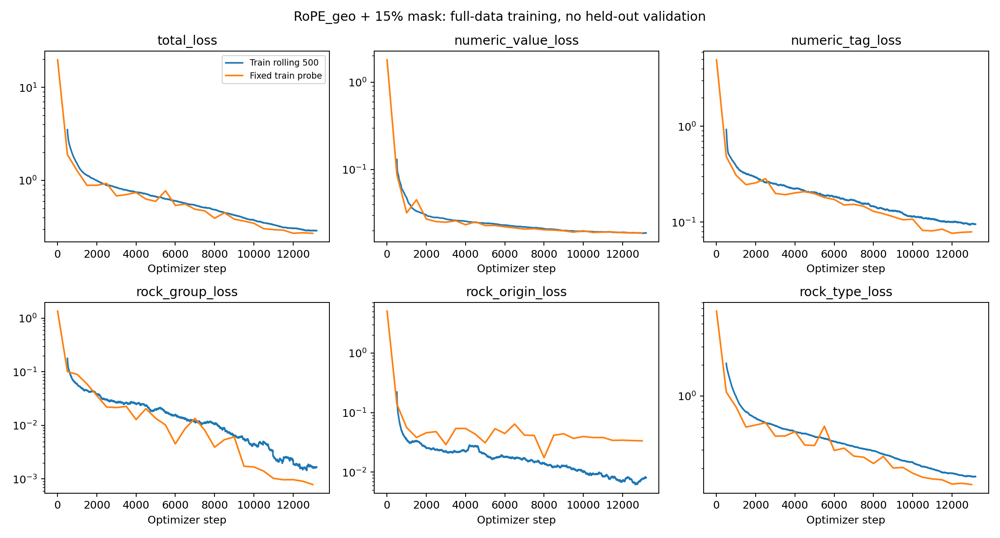
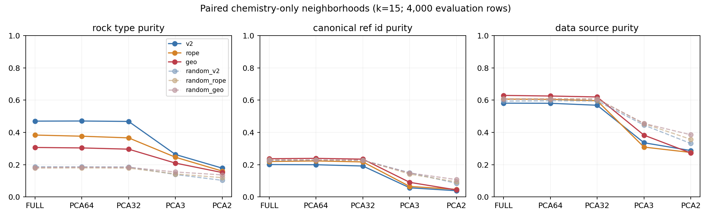
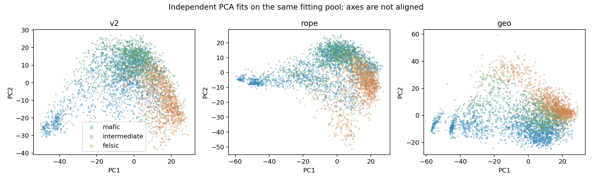
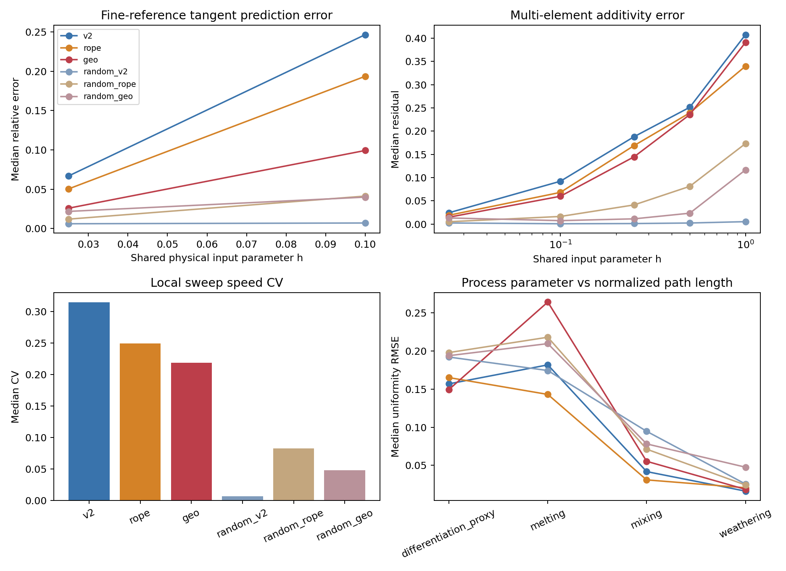
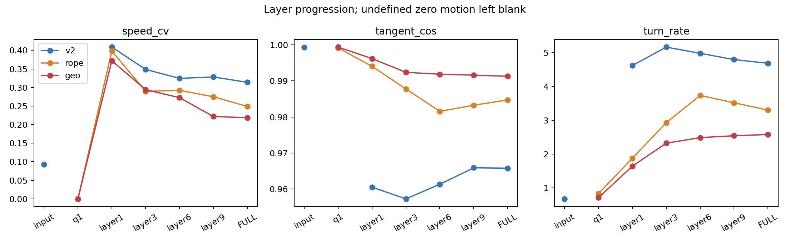

# RoPE_geo + 15% mask：训练后独立分析

分析日期：2026-09-13。比较对象为 V2、RoPE-z、RoPE_geo+15%mask，以及三者对应的随机初始化对照。旧 RoPE-z 报告及其结论未改动。

## 结论

**这次实验保留并改善了若干小步长局部几何指标，但没有修复 chemistry-only 全局 latent；岩石邻域进一步变弱，reference/source 聚集反而增强。** 不建议把它替换为当前最佳全局地质表示。

它也不是完全没有学到东西：geo 的 contextual probe、岩石邻域和数值预测均优于其随机/简单基线。但是这种训练后新增结构，比 V2/RoPE-z 更少地体现为可用的 chemistry-only 岩石邻域。平滑性不能代替这个目标。

## 训练完整性与数据边界

- 完成 13,200 个连续 optimizer steps、50 个名义 epoch；最终学习率 3e-6。
- 参数量 85,255,040；所有训练损失和 checkpoint 权重有限，无 NaN/Inf。
- batch 512、梯度累积 2；最后不足整批的行为沿用原训练实现。
- 整轮实际 numeric masked/eligible 比例为 **15.00045%**，仅数值任务样本启用。
- 最后 500 步训练总损失均值 0.28947；最后定期 probe 在 13,000 步。
- 已另外评估最终 13,200 步 checkpoint：固定训练 probe 总损失 **0.26644**，numeric Huber **0.018780**；该 probe 含 12,261 个 numeric targets。
- 数据仍是全量 270,241 行训练；8192 样本 probe 不是验证集。分析的 8000/4000 划分只隔离 PCA fitting/evaluation，不能隔离预训练暴露。

主量闭合规则覆盖 161,270 行（59.6764%）。PM 参考值、平方根质量分数公式、回退、epsilon 和 family scale 均保留在 [实验说明](README.md) 和版本化 YAML 中。

### 低 numeric loss 是否只是任务变容易？

最终 probe 与“每种元素总预测其训练坐标中位数”的静态基线比较：

| 数值族 | masked targets | 模型 Huber | 元素中位数 Huber | 相对改善 |
|---|---:|---:|---:|---:|
| 主量 | 5858 | 0.000872 | 0.002712 | 67.8% |
| 微量 | 5980 | 0.037399 | 0.136712 | 72.6% |
| LOI/CO2 | 423 | 0.003564 | 0.005454 | 34.6% |

模型确实学到了超过元素常数的信息；但主量目标的损失尺度很小。不同版本使用不同坐标、mask 数量，绝不能直接用 numeric Huber 的绝对值排列模型优劣。闭合本身还会提供组分和约束。

最终训练 probe 的元素标签准确率 97.35%，rock group 100%，origin 99.49%，type 95.62%。标签任务仍可能看到其余岩石标签；这些分数不能当作 chemistry-only 或未见来源的泛化结果。

## Paired comparison 方法

- 原 12,000 个 sample IDs、顺序与随机种子 42 保持不变；PCA 在原 8000 fitting pool 拟合，邻域主指标在同一 4000 evaluation pool 内留一计算。
- 主结果完全移除岩石标签 token，使用有效 numeric token 的均值；另测 CLS 和全部岩石标签被 mask 的模式。
- 主空间 FULL、PCA64、PCA32，另保留 PCA3/PCA2；全局主均值空间还检验各维度十个固定随机正交投影。
- 所有方向比较均在各模型自己的空间内计算；从未把独立模型或独立 PCA 的坐标轴直接对齐后比较。
- 全局 purity 的 CI 使用 reference-cluster paired bootstrap；局部导数 CI 按原自然样本聚类，不把同一样本的多个 h 当作独立重复。
- 连续扰动从原 z 反变换到同一份物理浓度，再按各模型自己的预处理编码；未改变的自然样本浓度从原始 metadata 恢复。这里的 h 是原 z 所参数化的共同物理扰动，**不是 geo 原生角度的 h**。
- 对旧缓存无法唯一反演的截断点、无效负浓度及闭合切换做明确筛选。26,277 个主刺激中 24,106 行满足主 admissibility；完整无切换的局部 sweep 有 25 条。保留同一筛选给所有模型。
- 对 mixing/melting 另读取原实验保存的 **228 条精确原始浓度**重放，包括原 z 截断的碳酸盐端点；已验证重新得到的 baseline z 与原缓存一致。跨闭合阈值路径单独标记。
- token-drop 在计算坐标后删除 token，避免无意把“少一个 token”变成“重新闭合全体主量”。
- 126 条代表性 fine-step 输入经 CPU 重放：h=.005 的 CPU/MPS 切向 cosine 最小约 0.999999，导数相对误差最大约 0.114%。本次训练 geo 的主要差异高于这一数值底。未把近零位移解释为完美稳定。

## 全局守门指标：明确未通过

下表均为 chemistry-only mean-numeric、k=15。purity 越高表示邻域同类比例越高；source/reference 越高在此是混杂风险，而非奖励。

| 指标 | V2 | RoPE-z | RoPE_geo+15%mask |
|---|---:|---:|---:|
| FULL rock-type purity | 0.4698 | 0.3835 | **0.3065** |
| FULL kNN accuracy | 0.6083 | 0.5091 | **0.4126** |
| FULL kNN balanced accuracy | 0.3407 | 0.2394 | **0.1554** |
| PCA64 rock-type purity | 0.4705 | 0.3763 | **0.3036** |
| PCA32 rock-type purity | 0.4679 | 0.3659 | **0.2959** |
| FULL reference purity | 0.2005 | 0.2194 | **0.2367** |
| FULL source purity | 0.5812 | 0.6063 | **0.6293** |

相对 RoPE-z，geo 的 FULL rock purity 差为 **−0.0770**，95% CI [−0.0840, −0.0688]；reference 差为 **+0.0173**，CI [+0.0038, +0.0327]；source 差为 **+0.0230**，CI [+0.0093, +0.0376]。这不是只在一张 PCA 图上看到的现象。k=30 结果见完整指标表。

分闭合状态后，geo 的岩石 purity 也都更低：

| 4000 evaluation 子集 | 样本数 | V2 | RoPE-z | geo |
|---|---:|---:|---:|---:|
| 满足闭合 | 2409 | 0.4409 | 0.3478 | 0.2647 |
| 回退坐标 | 1591 | 0.5142 | 0.4381 | 0.3705 |

source 增强主要见于闭合子集（RoPE-z 0.5558 → geo 0.5969），回退子集略降（0.6840 → 0.6791）。因此既不能把问题完全推给回退样本，也不能把“source 增强”解读为已证实的单一因果机制。

### Pooling、PCA 与随机对照

geo 的 CLS chemistry-only accuracy 为 0.5075，明显高于其 mean-numeric 的 0.4126，但仍低于 V2 CLS 的 0.5739。把岩石标签 token 留作 MASK 后，geo mean-numeric purity 为 0.3206，仍远低于 V2 的 0.4734。缺陷不只是一次提取时忘记添加 MASK token。

geo 的 PC1 解释 23.29% 方差，前三 PC 39.65%，PCA32 88.45%，PCA64 95.75%；V2 对应约 12.67%、26.47%、80.82%、91.21%。更集中不等于更有地质意义。

随机 geo 的 FULL rock purity 为 0.1820，训练后为 0.3065；随机 V2/RoPE-z 为 0.1869/0.1789。geo 有训练增益，但小于 V2/RoPE-z。这不是整个 latent 变成常量的 collapse。

## 局部几何：多数小步长指标保留或改善

以下均为共同 admissible 输入，FULL 空间的中位数。fine reference 使用 h=.005。

| 指标 | V2 | RoPE-z | geo |
|---|---:|---:|---:|
| fine-reference direction cosine，h=.1 | 0.994018 | 0.998060 | **0.999884** |
| fine-reference predictor error，h=.1 | 0.2464 | 0.1935 | **0.0992** |
| local sweep speed CV | 0.3140 | 0.2489 | **0.2187** |
| local sweep adjacent tangent cosine | 0.9658 | 0.9847 | **0.9913** |
| 多元素 additivity residual，h=.025 | 0.0245 | 0.0191 | **0.0149** |
| 多元素 additivity residual，h=.1 | 0.0922 | 0.0683 | **0.0600** |
| 连续满足 error≤10%、cosine≥.99 的局部半径 | 0.025 | 0.050 | **0.100** |

在自然样本的主导数测试 h=.1 上，相对 RoPE-z 的 predictor-error paired cluster mean 差为 −0.0852，95% CI [−0.0967, −0.0740]；relative curvature 差为 −1.462，CI [−1.618, −1.301]。

这不是所有尺度都更优：h=1 时 geo 的联合残差为 0.391，RoPE-z 为 0.340。不能把小步优势扩展为大范围线性。

同元素的跨化学背景方向 cosine 中位数，geo 为 0.402，RoPE-z 为 0.240，V2 为 0.245；同背景分别约 0.529/0.316/0.328。geo 响应方向更一致，但结合下文语义 probe 的下降，也可能反映背景调制减弱。

随机模型经常比训练模型更平滑：随机 geo 的 local speed CV 仅 0.0478、random V2 约 0.0069；随机模型却没有良好的岩石邻域。geo 的改善不能直接解释为“学到了更多地质语义”。

### 层间与 Jacobian

直接标签输入不随可见数值变化，零位移指标留空；数值几何从旋转后的 Q/K 开始进入上下文。浅、中、深层持续改变速度与弯曲程度，输入的连续旋转并未被原样保留。

在同一物理参数化下，自然背景 Jacobian 的汇总参与秩约为 V2 2.76、RoPE-z 4.38、geo 4.85；这仅是当前刺激和尺度下的局部有效秩，不代表一个普适“地化潜维度”。

## 过程路径：并非全面改善

保持同一过程参数和原始浓度端点，主要结论是：

- **部分熔融变得更不均匀**：speed CV 由 RoPE-z 0.613 → geo 0.959；归一化路径长度相对参数的 uniformity RMSE 由 0.143 → 0.264。切向更平滑也没有使速度均匀。
- **混合没有全面改善**：精确原始浓度重放、无闭合切换的路径中，RoPE-z speed CV 0.214，geo 0.324；uniformity RMSE 0.0297 → 0.0526。
- **风化局部平滑性改善**：speed CV 0.107 → 0.0634，adjacent tangent cosine 0.962 → 0.998；但参数均匀性相对 V2 并无一致胜出。
- Rayleigh 分异代理的速度与参数均匀性略改善。它仍是简化代理过程，不能当作自然岩浆演化验证。
- 原始碳酸盐线性混合中有跨闭合阈值的路径，单独报告。预处理切换会引入跳变，不能算作 Transformer 自身曲率。

共同 trace 倍乘、单 Rb 倍乘和 Rb/Sr contrast 的响应均已重跑。geo 的共同 trace shift 仍有非零响应，因此它并非只编码 ratios。共同闭合主量缩放的不变性来自归一化公式，而不是已经学到的关系推理能力。详细敏感度表保留原实验的输入范数定义，不混用不同模型的角坐标单位。

## 上下文与 missing-token robustness

固定同一原始元素值、按 reference 分组的 background probe balanced accuracy：

| V2 | RoPE-z | geo | 随机 geo |
|---:|---:|---:|---:|
| 0.9233 | 0.9080 | **0.8409** | 0.4285 |

geo 仍具明显上下文信息，但比两个已训练基线弱。额外把 queried geo 坐标也固定后，结果约 0.8422；因此不能仅用“主量闭合改变了 fixed-raw-value 的坐标”解释整个下降。这些 grouped probe 的源数据仍参与过预训练，不能声称严格未见来源泛化。

随机删除 10% token 时，geo latent cosine 保持度较高（0.735，RoPE-z 0.654，V2 0.621），但配对 400 样本的岩石 kNN accuracy 仍较低：geo 0.232，RoPE-z 0.288，V2 0.394。表示对删除更不敏感，不等于缺失条件下预测更好。

## Phase wrapping / distant collision

主压力测试使用共同物理端点、原 z 参数差≥4，geo 在 90,744 对中未出现“远距离 latent 比中位相邻步还近”的事件；RoPE-z 有 2 对，均不落在这里的完整观测支持筛选内。

在完整训练观测范围筛选后，各模型共同测试 13,890 对，均为零；1–99% 中心支持仅有 135 对，覆盖很有限。有限采样的零事件不是全局无碰撞证明。

更值得注意的是**坐标压缩而非绕圈**：某些主量远端对的完整多频 phase similarity 仍高达约 0.999，但相应 geo 角差仅约 0.18–0.19，而不是重新绕了 2π。这提示统一 scale=1 下主量角差很小；仅凭这些结果不能证明它就是全局语义退化的原因。

完整频率集合在最快频率走一圈后不会整体回到原位。检查使用全部 32 个频率对，而不是只看第一对的周期。

## 如何解释，以及下一步

本轮同时改变 coordinate 与 numeric mask 密度，无法区分二者各自的因果作用。证据支持的是“这个组合改善部分局部几何，却进一步损害主 chemistry-only 邻域”。

较合理的待检验解释包括：主量角差被压缩、不同数值族的 Huber 尺度改变、mask 密度改变任务学习分配，以及报告 panel/闭合规则与来源的耦合。均不能从当前单个组合实验断言。

下一步优先补齐最小 2×2 消融：**原 z + 15% mask**、**geo + 原单数值 mask**，保持其他设置不变。再决定是否调整 family scale。当前没有证据表明单纯延长这一轮训练能修复 global latent，也不应把低 numeric loss 当作选型标准。

## 交付与复现

- [坐标、PM 值、闭合规则与训练命令](README.md)
- [预注册 paired protocol](PAIRED_PROTOCOL.md)
- [分析复现命令](ANALYSIS_REPRODUCE.md)
- [完整全局指标](quality.csv)、[paired CI](quality_paired_ci.csv)
- [fine-step 汇总](fine_steps_summary.csv)、[局部导数](derivatives_summary.csv)、[联合扰动](joints_summary.csv)
- [过程精确浓度重放](raw_process_summary.csv)、[context probe](context.csv)、[token dropout](dropout.csv)
- [支持范围内碰撞](support_collisions_summary.csv)、[phase 汇总](phase_summary.csv)
- [最终数值任务分解](final_numeric_by_family.csv)、[分析校验](analysis_verification.json)

所有 checkpoint、sample IDs、latent 数组、逐样本表和 PCA bases 仍仅存在于新的 Git-ignored 输出目录；公开交付只有代码、汇总表和静态科学图。旧实验结果和旧 REPORT.md 均未改动。
