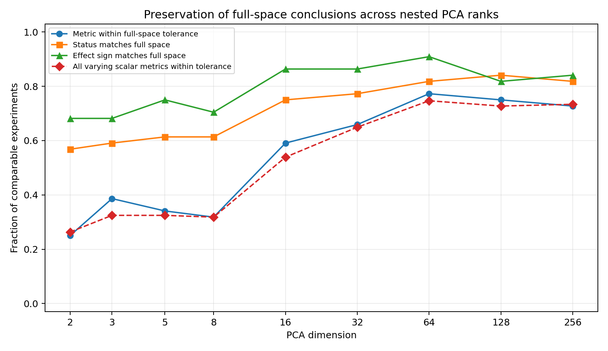
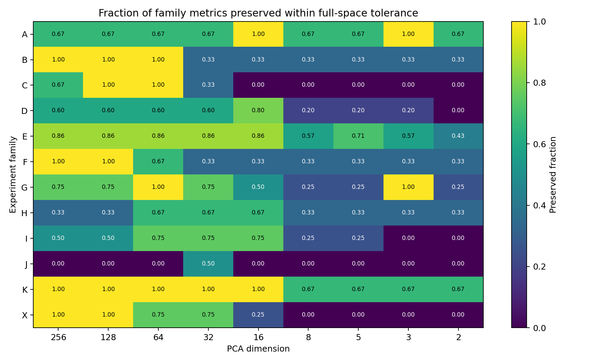

# Element2Vec V2 PCA 低秩子空间复核报告

## 1. 执行摘要

本轮将 Stage 3.6 的 **50 个实验**分别放入
**256、128、64、32、16、8、5、3、2D** 的嵌套 PCA 子空间中复算，
共形成 **450 条 experiment × dimension 结果**。完整覆盖校验：
**通过**。

| classification | experiments |
| --- | --- |
| low-rank preserved | 22 |
| low-rank enhanced | 11 |
| rank-sensitive above 32D | 8 |
| dimension-invariant / unavailable | 6 |
| strongly rank-sensitive | 3 |

主要结论不是“越低维越好”，而是存在一个明显的层级：

1. **64D 基本保留主体结构。** 77.3% 的主指标、74.7% 的
   全部变化标量仍在原高维结果容差内；32D 分别降至 65.9% 和
   64.9%。
2. **8D 以下发生普遍坍缩。** 8D 仅 31.8% 的主指标接近高维结果，
   2D 仅 25.0%。因此模型语义并非主要压缩在单一2–8D流形中。
3. **最前面的PC首先保留数据来源，而不是完整地质结构。** X4 中 trained
   source purity 在64D为 0.960、2D仍为 0.946；
   rock-type purity 却从 0.438 降到 0.128。
   这说明2D图中的主导分区很可能优先反映分析来源/缺失面板。
4. **contextual语义主要需要32–64D。** C1/C2/C3 在64D仍接近高维结果，
   但在16D以下持续衰减。元素上下文不是单一低维轴，而是中等秩结构。
5. **部分过程方向确实集中在低秩子空间。** F1/F2在5–3D对共同岩性/单元素
   响应方向的对齐更强，F3在低维更接近加性；这更像“共同响应方向被保留、
   背景特异和非线性残差位于较高秩”，不能简单解释为低维更懂地质过程。

这里的“低秩增强”只表示原实验的预注册指标在较低维度更强，不自动等于
更真实的地质语义。PCA 使用全审计样本无监督拟合，仍可能优先保留数据来源、
缺失模式或受标签监督塑造的高方差方向。

## 2. 方法

- 对每种表示分别拟合一次最大 256D PCA，然后截取前 k 个主成分；因此九个
  子空间严格嵌套，维度差异不会来自重复拟合的随机旋转。
- PCA 只中心化、不白化。距离、夹角、邻域、probe、轨迹和检索指标均在
  对应低维坐标中重新计算。
- numeric-only、masked-label 和 visible-label sample latent 使用同一 trained
  PCA 基底；随机模型使用自身基底。
- H/X 跨样品—标签空间比较将标签投影到 sample encoded-mean 的同一 PCA
  基底，避免在两个独立旋转后的坐标系中直接计算余弦。
- raw/log/CLR 等传统对照保持原定义；被降维的是 Element2Vec 表示。
- 静态 numeric tag 只有约 34 个可用秩，纯标签约 95 个可用秩；请求维度超过
  数据秩时记录实际有效维度，不虚构额外主成分。

PCA 基底方差记录见 [`basis_manifest.csv`](../basis/basis_manifest.csv)。

| basis_name | fitted_components | variance_2d | variance_8d | variance_16d | variance_32d | variance_64d | variance_128d | variance_256d |
| --- | --- | --- | --- | --- | --- | --- | --- | --- |
| sample_trained_cls | 256 | 0.3565 | 0.5701 | 0.6803 | 0.7829 | 0.8648 | 0.9268 | 0.9689 |
| sample_trained_encoded_mean_numeric | 256 | 0.2057 | 0.482 | 0.6577 | 0.8077 | 0.9117 | 0.9611 | 0.9854 |
| sample_trained_projected_mean_numeric | 256 | 0.8388 | 0.9418 | 0.972 | 0.9945 | 0.9998 | 1 | 1 |
| token_trained_contextual | 256 | 0.074 | 0.2388 | 0.4089 | 0.6381 | 0.8178 | 0.9097 | 0.9635 |
| token_trained_projected | 256 | 0.3104 | 0.5144 | 0.7229 | 0.9694 | 0.9995 | 1 | 1 |

这组方差谱本身也说明不同表示层的秩不同：projected mean 在2D已解释约84%的
方差，而 contextual token 在16D仅解释约41%、32D约64%；Transformer 写入的
样品上下文明显比输入 MLP token 更分散。

## 3. 总体维度敏感性

| pca_dimension | experiments | numerically_comparable | within_full_tolerance_fraction | status_match_fraction | effect_sign_match_fraction | median_absolute_delta_from_full | strong_positive | moderate_positive | weak_ambiguous | negative | invalid_or_failed | informative_scalar_metrics | all_scalar_within_full_tolerance_fraction | all_scalar_median_absolute_delta_from_full |
| --- | --- | --- | --- | --- | --- | --- | --- | --- | --- | --- | --- | --- | --- | --- |
| 256 | 44 | 44 | 0.7273 | 0.8182 | 0.8409 | 0.0057 | 14 | 5 | 13 | 11 | 1 | 154 | 0.7338 | 0.0057 |
| 128 | 44 | 44 | 0.75 | 0.8409 | 0.8182 | 0.0096 | 15 | 4 | 14 | 10 | 1 | 154 | 0.7273 | 0.0103 |
| 64 | 44 | 44 | 0.7727 | 0.8182 | 0.9091 | 0.0069 | 14 | 5 | 14 | 10 | 1 | 154 | 0.7468 | 0.0099 |
| 32 | 44 | 44 | 0.6591 | 0.7727 | 0.8636 | 0.0229 | 12 | 6 | 13 | 12 | 1 | 154 | 0.6494 | 0.0215 |
| 16 | 44 | 44 | 0.5909 | 0.75 | 0.8636 | 0.028 | 13 | 7 | 14 | 9 | 1 | 154 | 0.539 | 0.0305 |
| 8 | 44 | 44 | 0.3182 | 0.6136 | 0.7045 | 0.0679 | 13 | 4 | 14 | 12 | 1 | 154 | 0.3182 | 0.0679 |
| 5 | 44 | 44 | 0.3409 | 0.6136 | 0.75 | 0.091 | 14 | 5 | 12 | 12 | 1 | 154 | 0.3247 | 0.0899 |
| 3 | 44 | 44 | 0.3864 | 0.5909 | 0.6818 | 0.1091 | 12 | 7 | 11 | 13 | 1 | 154 | 0.3247 | 0.1118 |
| 2 | 44 | 44 | 0.25 | 0.5682 | 0.6818 | 0.1278 | 13 | 6 | 13 | 11 | 1 | 152 | 0.2632 | 0.1259 |

## 4. 低秩集中或放大候选

这些实验在不高于 32D 时，按预先声明的
指标方向强于256D，并且至少一个低维点接近原始高维指标。它们说明有效信号可能
集中在前若干PC；并不表示一定超过原始表示或传统基线。尤其是内部再次执行
StandardScaler/PCA 的 probe，新增低方差PC可能被等权放大，因此非单调曲线也可能
来自实验管线而非模型语义。

| experiment_id | family | metric_primary | full_metric_value | metric_direction | smallest_dimension_within_full_tolerance | strongest_metric_dimension | metric_range_across_dimensions | full_confounder |
| --- | --- | --- | --- | --- | --- | --- | --- | --- |
| I3_ideal_norm_retrieval | I | ideal_mixture_expected_family_mrr | 0.65 | higher is stronger | 16 | 5 | 0.428388 | Ideal oxide mixtures omit trace elements and may be out of the training distribution; expected families are broad and the norm construction is approximate. |
| D3_global_axes | D | mean_best_axis_abs_spearman | 0.476668 | higher is stronger | 3 | 8 | 0.425659 | PCA axes are rotation-dependent and several derived indices are deterministic functions of model inputs. The attempted spectral nonlinear scan crashed in native code and is recorded separately rather than silently removed. |
| G4_magmatic_sequences | G | mean_sequence_pc1_monotonicity | 0.6 | higher is stronger | 3 | 32 | 0.4 | With only five labels per sequence, PCA ordering is unstable and does not prove a globally linear magmatic-evolution axis. |
| I1_normative_readability | I | mean_normative_mineral_cv_r2 | 0.623862 | higher is stronger | 16 | 32 | 0.329936 | This is not a strict CIPW allocation: NNLS permits non-unique and mutually incompatible normative phases. It is a broad mineralogical proxy and is explicitly labeled as such. |
| G5_other_geological_relations | G | alkaline_relation_cosine | 0.237157 | higher is stronger | 3 | 8 | 0.289084 | The three label pairs do not represent identical petrogenetic comparisons and one is not a strict paired equivalent. |
| D5_external_isotopes_age | D | external_isotope_age_grouped_r2 | 0.255422 | higher is stronger | 16 | 16 | 0.26701 | Isotope coverage is sparse and publication-specific; grouped folds reduce but do not eliminate analytical-source confounding. |
| A3_ree_sequence | A | abs_pc1_atomic_number_spearman | 0.4 | higher is stronger | 2 | 2 | 0.2 | Four irregularly spaced REE tags cannot establish an LREE–MREE–HREE sequence or test Ce/Eu anomalies. PCA sign and axis selection are unstable at n=4. |
| G2_volcanic_plutonic | G | combined_relation_cohesion_and_mrr | 0.425812 | higher is stronger | 3 | 5 | 0.141812 | Rock-type labels are partly computed from chemistry and share lexical/classification structure; a global translation may obscure local nonlinear relations. |
| J1_beyond_traditional_indicators | J | mean_balanced_accuracy_increment_over_traditional_indicators | 0.176794 | higher is stronger | 32 | 32 | 0.11949 | The checkpoint was trained with these labels on the same full dataset; this measures conditional decodability and cannot establish independent predictive value. |

以下指标虽然被低秩放大，但原实验仍为 Negative，不能据此恢复原假设：

| experiment_id | metric_primary | full_metric_value | strongest_metric_dimension | metric_range_across_dimensions | full_confounder |
| --- | --- | --- | --- | --- | --- |
| A2_geochemical_affinity | combined_pair_and_group_effect | -0.000857761 | 2 | 0.0678433 | Geochemical group assignments overlap and are context-dependent; six canonical pairs cannot be tested because one or both tags were never trained. |
| H2_centroid_label_alignment | leave_one_class_out_alignment_top1 | 0.0533333 | 16 | 0.04 | Class centroids and label embeddings both inherit training labels; leave-one-class-out limits mapping capacity but is not an independent test set. |

## 5. 代表性实验曲线数据

| experiment_id | metric_primary | full_metric_value | 256 | 64 | 32 | 16 | 8 | 2 |
| --- | --- | --- | --- | --- | --- | --- | --- | --- |
| C1_same_value_context | mean_contextual_background_probe_gain | 0.9421 | 0.9283 | 0.9337 | 0.8821 | 0.8145 | 0.7302 | 0.4891 |
| C2_element_role_proxies | mean_contextual_role_proxy_gain | 0.2212 | 0.1975 | 0.2038 | 0.1585 | 0.1254 | 0.0676 | -0.0138 |
| C3_contextual_neighbors | geology_minus_source_neighbor_gain | 0.1309 | 0.1305 | 0.1259 | 0.1043 | 0.0847 | 0.0643 | 0.0015 |
| D1_rock_continuity | rock_type_knn15 | 0.3997 | 0.3981 | 0.3975 | 0.3938 | 0.3894 | 0.359 | 0.1745 |
| D2_local_geological_neighbors | geology_neighbor_purity | 0.6115 | 0.6095 | 0.6092 | 0.6053 | 0.5983 | 0.576 | 0.4588 |
| F1_lithology_perturbation | perturbation_to_class_direction_cosine | 0.2925 | 0.2972 | 0.315 | 0.3309 | 0.3543 | 0.3944 | 0.5886 |
| F2_single_element_jacobian | cross_background_single_element_direction_cosine | 0.395 | 0.4142 | 0.4443 | 0.459 | 0.511 | 0.5347 | 0.4705 |
| F3_combined_interventions | combined_vs_additive_direction_cosine | 0.9423 | 0.9467 | 0.9546 | 0.9638 | 0.9792 | 0.9822 | 0.9838 |
| J1_beyond_traditional_indicators | mean_balanced_accuracy_increment_over_traditional_indicators | 0.1768 | 0.042 | 0.1294 | 0.1614 | 0.1502 | 0.1076 | 0.0511 |
| J2_grouped_increment | publication_grouped_balanced_accuracy_increment | 0.1006 | 0.0416 | 0.0704 | 0.0742 | 0.0712 | 0.0473 | 0.0311 |
| K1_representation_baselines | rock_type_knn15_against_best_traditional | 0.4588 | 0.4585 | 0.4601 | 0.4584 | 0.448 | 0.3957 | 0.1094 |
| X4_random_missingness_followup | net_geology_over_source_gain_vs_random | 0.3156 | 0.3159 | 0.3178 | 0.3184 | 0.3155 | 0.2767 | 0.0611 |

## 6. 低秩保留结果

| experiment_id | family | metric_primary | full_metric_value | smallest_dimension_within_full_tolerance | status_match_fraction | full_confounder |
| --- | --- | --- | --- | --- | --- | --- |
| A1_periodic_properties | A | mean_delta_cv_r2_vs_random | 0.00347859 | 2 | 1 | Only 33 tags map cleanly to a central element; oxide tags duplicate some cations, and common valence/ionic radius are coordination-dependent approximations. |
| K3_order_dropout_robustness | K | token_order_invariance_cosine | 1 | 2 | 1 | Dropout is uniform over observed fields and does not mimic element-specific analytical panels or detection limits. |
| K2_input_mode_stability | K | numeric_only_vs_masked_label_cosine | 0.974183 | 2 | 1 | All modes use a model trained mostly with visible labels. Numeric-only and all-masked inputs are both distribution shifts, so agreement is reassuring but disagreement is not uniquely attributable. |
| H1_sample_label_retrieval | H | direct_sample_to_label_top1 | 0.0233333 | 2 | 1 | Projected pure-label tokens and contextual pooled sample latents are different representation levels; direct cosine is a diagnostic and may be geometrically invalid. |
| G1_label_neighbors | G | pure_label_field_knn5_purity | 0.776344 | 2 | 1 | Field identity is encoded directly in token names and separate field-level mask tasks, so field clustering is not geological semantic evidence by itself. |
| F3_combined_interventions | F | combined_vs_additive_direction_cosine | 0.942313 | 2 | 1 | Interventions operate in independently standardized z units and do not enforce closure; high additivity can be architectural rather than geological. |
| E7_metamorphic | E | matched_rock_types | 11 | 2 | 1 | Rock_group metamorphic may encode protolith inheritance and naming practices; no metamorphic grade or paired protolith sample is available. |
| E5_weathering_sediment | E | weathering_intensity_monotonicity | 1 | 2 | 1 | The perturbation is a compositional proxy, not a mass-balanced weathering model; closure can conflate leaching with relative enrichment. |
| E6_hydrothermal | E | alteration_proxy_monotonicity | 1 | 2 | 1 | No alteration labels or fresh–altered pairs exist in the trained view; closure and arbitrary magnitude choices dominate this synthetic test. |
| B1_numeric_trajectories | B | median_pc1_monotonicity | 1 | 2 | 1 | The grid is in per-field robust-z space, so equal steps do not mean equal absolute or log-fold concentration changes. This tests encoder geometry, not natural-sample frequency. |
| E4_partial_melting | E | melt_fraction_monotonicity | 1 | 3 | 1 | Partition coefficients are broad proxies, major elements are held fixed, and the V2 vocabulary lacks a complete REE panel; this is a geometry stress test, not petrological modeling. |
| E1_two_endmember_mixing | E | mean_mixing_parameter_monotonicity | 0.961364 | 5 | 0.777778 | Median endmembers combine unrelated publications and are not physical coexisting endmembers. Linear oxide mixing and major closure omit density, volatile, and mineralogical constraints. |
| I2_normative_assemblages | I | normative_assemblage_knn15 | 0.883822 | 5 | 0.444444 | Assemblage labels are derived by argmax from an approximate and non-unique NNLS norm, so they are not mineral observations. |
| D2_local_geological_neighbors | D | geology_neighbor_purity | 0.611489 | 8 | 0.666667 | Source purity and geology purity are not on identical class-cardinality baselines; publication IDs also proxy real suites and localities. |
| E2_multiendmember_simplex | E | simplex_distance_rank_preservation | 0.92001 | 16 | 1 | Distance-rank preservation does not prove triangular topology; the three median endmembers are synthetic and may pass through compositions absent from nature. |
| D4_geographic_neighbors | D | median_geographic_neighbor_distance_km | 5933.29 | 16 | 1 | Coordinates may be rounded or publication-level, and geographic proximity can represent real suites as well as leakage. |
| D1_rock_continuity | D | rock_type_knn15 | 0.399667 | 16 | 0.777778 | The checkpoint used rock labels during full-data training, so rock-label organization is decodability, not out-of-sample discovery. Missingness is present in both spaces. |
| K1_representation_baselines | K | rock_type_knn15_against_best_traditional | 0.458778 | 16 | 0.555556 | Rock-type purity is label-contaminated by full-data multi-task training and can also be inflated by source/missingness structure. |
| X4_random_missingness_followup | X | net_geology_over_source_gain_vs_random | 0.315617 | 16 | 1 | A random set encoder can preserve or amplify analytical-panel patterns; sample_id ordering and source imbalance also affect this control despite matched rows. |
| X2_role_raw_control | X | grouped_role_proxy_balanced_accuracy | 0.828587 | 32 | 0.222222 | The process proxies are algebraic or strongly correlated functions of input chemistry, so matching raw performance is expected and exceeding it would require careful validation. |
| C1_same_value_context | C | mean_contextual_background_probe_gain | 0.942144 | 32 | 0.555556 | SiO₂ background is a coarse proxy, and contextual tokens can exploit reporting patterns or correlated fields rather than mineralogical role. |
| X1_context_raw_control | X | grouped_background_balanced_accuracy | 0.940094 | 32 | 0.444444 | The background label is defined directly by SiO₂, which is present in raw context and attended by the contextual token. This tests context transmission, not information beyond chemistry. |

## 7. 依赖较高秩或高度不稳定的结果

| experiment_id | family | metric_primary | full_metric_value | metric_range_across_dimensions | status_match_fraction | effect_sign_match_fraction | full_confounder |
| --- | --- | --- | --- | --- | --- | --- | --- |
| E3_magmatic_differentiation | E | natural_sequence_monotonicity | 0.85 | 0.6 | 0.222222 | 0.333333 | Rock_type is chemistry-derived, class centroids mix unrelated suites, and label supervision was used in checkpoint training. |
| X3_cross_space_relation_followup | X | cross_space_relation_structure_spearman | 0.320779 | 0.433766 | 0.888889 | 0.777778 | Both spaces inherit the same label-supervised checkpoint; this comparison avoids direct cross-space vector subtraction but not training-label contamination. |
| F1_lithology_perturbation | F | perturbation_to_class_direction_cosine | 0.292531 | 0.322898 | 0.111111 | 1 | Class directions are label-contaminated, and the perturbation changes only major oxides while natural basalt/rhyolite differences include trace elements and source effects. |
| C2_element_role_proxies | C | mean_contextual_role_proxy_gain | 0.221177 | 0.217624 | 0.444444 | 0.777778 | Mg#, Sr/Y, MALI, and SiO₂ are process proxies, not unique process labels; high readability can reflect direct compositional covariance. |
| B3_numeric_scale_consistency | B | combined_direction_and_scale_consistency_gain | -0.105275 | 0.212147 | 0.888889 | 0.444444 | A shared MLP mechanically encourages some common direction even before training. Per-field robust scaling also makes equal z steps distributional rather than physically equivalent. |
| I4_label_residual_norms | I | label_residual_normative_abs_spearman | 0.223904 | 0.210712 | 1 | 1 | The alignment is fit on the same classes and the norm is approximate; selecting the best of 12 PCs inflates correlations and is exploratory only. |
| F2_single_element_jacobian | F | cross_background_single_element_direction_cosine | 0.394983 | 0.148914 | 1 | 1 | Changing one transformed token ignores closure and may create impossible compositions; response directions include attention redistribution and missingness context. |
| C3_contextual_neighbors | C | geology_minus_source_neighbor_gain | 0.130925 | 0.128972 | 1 | 1 | Token reservoir is capped uniformly by field and the model was trained with hierarchical rock labels; neighbor purity is descriptive, not independent generalization. |
| B2_absolute_relative | B | ratio_to_common_displacement | 0.463446 | 0.126118 | 0.333333 | 1 | A token-wise MLP has no access to other elements or closure; this is a geometric superposition test, not evidence that the model explicitly represents geochemical ratios. |
| H3_cross_space_relations | H | cross_space_relation_distance_spearman | 0.0491423 | 0.0542401 | 1 | 0.444444 | Both spaces were produced by one label-supervised full-data checkpoint; relation agreement may reflect the supervised objective rather than emergent unsupervised geology. |
| J2_grouped_increment | J | publication_grouped_balanced_accuracy_increment | 0.10059 | 0.0431365 | 0.555556 | 1 | Encoder weights still saw all publications and labels during pretraining; grouped probes therefore remain transductive decodability checks. |

## 8. 次级定量指标检查

主指标不能覆盖实验内部的全部变化。例如 E7 的主指标是可匹配岩性数量，K3 的
主指标是顺序不变性，但它们还分别记录 centroid distance 和 token-dropout
cosine。本轮额外展开了所有 `metrics.json` 中的数值标量，并单独分析随维度变化
的指标。变化最大的次级指标如下：

| experiment_id | family | metric_name | full_metric_value | metric_range_across_dimensions | normalized_metric_range | smallest_dimension_within_full_tolerance |
| --- | --- | --- | --- | --- | --- | --- |
| D4_geographic_neighbors | D | encoded_minus_raw_km | -82.2941 | 2864.83 | 34.812 | 128 |
| X2_role_raw_control | X | contextual_minus_raw | -0.0247926 | 0.217713 | 8.78136 | 64 |
| G4_magmatic_sequences | G | random_mean_monotonicity | 0.05 | 0.35 | 7 | nan |
| G2_volcanic_plutonic | G | random_relation_mean_cosine | 0.00762294 | 0.121037 | 6.05186 | 5 |
| B3_numeric_scale_consistency | B | random_displacement_cv | 0.0729758 | 0.391442 | 5.364 | 64 |
| X1_context_raw_control | X | contextual_minus_raw | 0.100438 | 0.446257 | 4.44312 | 64 |
| E6_hydrothermal | E | mean_between_style_direction_cosine | 0.120135 | 0.518956 | 4.31979 | 2 |
| A2_geochemical_affinity | A | combined_primary_effect | -0.000857761 | 0.0678433 | 3.39216 | 3 |
| G5_other_geological_relations | G | random_relation_cosine | 0.165635 | 0.37758 | 2.27959 | 8 |
| E1_two_endmember_mixing | E | closure_straightness_delta | -0.00548791 | 0.0443973 | 2.21987 | 2 |
| A2_geochemical_affinity | A | mean_group_effect_delta | -0.00171552 | 0.041453 | 2.07265 | 3 |
| B3_numeric_scale_consistency | B | combined_consistency_gain | -0.105275 | 0.212147 | 2.01517 | 64 |
| D1_rock_continuity | D | encoded_minus_raw | 0.129244 | 0.223578 | 1.72988 | 16 |
| E7_metamorphic | E | mean_metamorphic_nonmetamorphic_centroid_distance | 0.112961 | 0.179476 | 1.58883 | 3 |
| X3_cross_space_relation_followup | X | relation_similarity_matrix_spearman | 0.320779 | 0.433766 | 1.35223 | 128 |
| A1_periodic_properties | A | mean_trained_distance_spearman | 0.0155752 | 0.0249449 | 1.24724 | 3 |
| A2_geochemical_affinity | A | trained_expected_pair_mrr | 0.157336 | 0.193357 | 1.22895 | 2 |
| G5_other_geological_relations | G | trained_relation_cosine | 0.237157 | 0.289084 | 1.21896 | 3 |
| F1_lithology_perturbation | F | mean_alignment | 0.292531 | 0.322898 | 1.10381 | 64 |
| H3_cross_space_relations | H | cross_space_distance_spearman | 0.0491423 | 0.0542401 | 1.10373 | nan |
| A1_periodic_properties | A | mean_delta_cv_r2_vs_random | 0.00347859 | 0.0209393 | 1.04697 | 2 |
| D5_external_isotopes_age | D | mean_latent_grouped_r2 | 0.255422 | 0.26701 | 1.04537 | 16 |
| C3_contextual_neighbors | C | mean_contextual_gains.reference_purity | 0.0727804 | 0.0755765 | 1.03842 | 64 |
| C3_contextual_neighbors | C | source_gain | 0.127963 | 0.129925 | 1.01534 | 64 |
| C3_contextual_neighbors | C | mean_contextual_gains.source_purity | 0.183145 | 0.184275 | 1.00617 | 64 |
| A2_geochemical_affinity | A | random_expected_pair_mrr | 0.157336 | 0.15763 | 1.00187 | nan |
| A3_ree_sequence | A | random_abs_pc1_atomic_number_rho | 0.2 | 0.2 | 1 | 5 |
| C3_contextual_neighbors | C | mean_contextual_gains.rock_type_purity | 0.192163 | 0.190692 | 0.992347 | 64 |
| C3_contextual_neighbors | C | geology_gain | 0.130925 | 0.128972 | 0.985076 | 64 |
| C2_element_role_proxies | C | mean_contextual_gain | 0.221177 | 0.217624 | 0.983935 | 64 |

逐指标全集见 [`all_scalar_metrics_long.csv`](all_scalar_metrics_long.csv) 和
[`scalar_metric_dimension_analysis.csv`](scalar_metric_dimension_analysis.csv)。

## 9. 解释边界

1. PCA 最大化方差而不是地质语义；低维结果变强可能是去噪，也可能是放大来源、
   缺失面板或训练标签方向。
2. 本轮是表示空间审计，不是独立泛化检验。checkpoint 仍在全数据标签监督下训练。
3. 一些 probe 实验内部原本还有 12D/24D 降维；代码现按外部 PCA 维数自动截断。
   因此 32–256D 区间可能出现平台，这是模型/实验设计共同导致的能力上限。
4. `B4`、`D3b`、`G3`、`I0`、`K4`、`K5` 属于变量缺失、依赖缺失或技术失败，
   其结论不会因 PCA 维度改变，但仍逐维保留以确保实验全集闭合。
5. 静态 element/tag 空间的样本数远小于 256，不能把高请求维数理解成高有效秩。

## 10. 后续建议

1. 后续定量分析建议把 **64D 作为主工作空间**：它保留率最高且仍有约91%的
   encoded-mean方差；32D适合作为压缩对照，不宜默认替代。
2. 2–8D只用于展示和诊断，不应承担主要地质结论。首先逐PC回归
   `data_source`、缺失token数、publication、SiO2和训练标签。
3. 深入F1/F2/F3时同时报告“低秩共同方向”和被截掉的高秩残差；后者更可能包含
   背景依赖、非线性交互或噪声，不能只保留更漂亮的低维对齐。
4. C1/C2/C3应在32、64D以及完整空间并列复核，并增加publication-held-out和
   真实分析面板控制，因为contextual语义与来源结构都集中在前几十个PC。
5. 优先复核低秩集中且原始混杂风险较低的实验；若某结果只在2–5D出现，应检查
   单一PC与来源变量的关系，不要直接命名为地质过程轴。

## 11. 数据与复现

- [`experiment_dimension_metrics.csv`](experiment_dimension_metrics.csv)：全部逐维原始结果
- [`experiment_dimension_analysis.csv`](experiment_dimension_analysis.csv)：逐实验敏感性分类
- [`all_scalar_metrics_long.csv`](all_scalar_metrics_long.csv)：全部 metrics.json 数值标量长表
- [`scalar_metric_dimension_analysis.csv`](scalar_metric_dimension_analysis.csv)：逐标量指标敏感性
- [`experiment_all_metric_summary.csv`](experiment_all_metric_summary.csv)：逐实验全指标汇总
- [`dimension_summary.csv`](dimension_summary.csv)：逐维总体统计
- [`family_dimension_summary.csv`](family_dimension_summary.csv)：逐家族统计
- [`figure_index.csv`](figure_index.csv)：逐实验维度曲线索引

本轮已登记运行时间合计约 **165.9 秒**。所有实验仍保留各自的配置、样本、
指标、观察、图表与错误记录。
