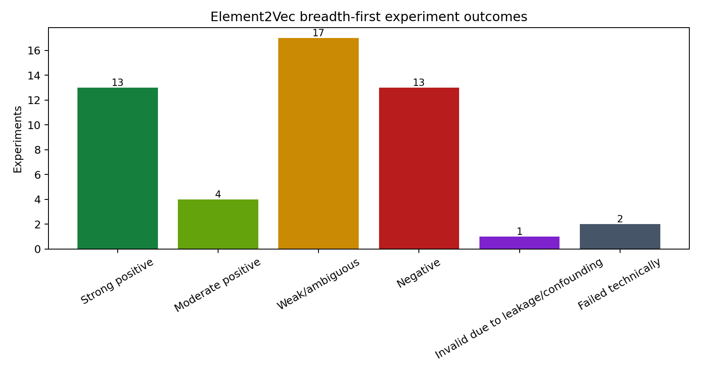

# Element2Vec V2 representation-space breadth-first exploration

## 1. Executive summary

This audit registered **50 experiments** across families A–K plus
targeted automatic follow-ups (X). The outcome distribution is:

| status | count |
| --- | --- |
| Strong positive | 13 |
| Moderate positive | 4 |
| Weak/ambiguous | 17 |
| Negative | 13 |
| Invalid due to leakage/confounding | 1 |
| Failed technically | 2 |

The clearest capability is not a Word2Vec-like periodic table. Static numeric
tag embeddings show essentially no trained-over-random periodic or broad
geochemical-affinity signal. Instead, the Transformer writes whole-sample
chemical context into each contextual token: at nearly fixed target-element
value, mafic/intermediate/felsic background remains highly readable. This is
partly useful context representation and partly expected because the token can
attend directly to SiO₂ and the full panel.

The largest risk is analytical-source structure. On exactly matched samples,
source-neighbor purity is about 0.94–0.96 in raw values, observation masks,
random Transformer latents, and trained latents. Training adds rock-type
structure, but it does not remove the source/reporting structure. In addition,
random 30% token removal reduces encoded-mean cosine to roughly 0.33, so the
model is permutation invariant but not robust to arbitrary panel loss.

The most defensible next directions are contextual finite-difference geometry,
publication-controlled conditional value, and realistic missing-panel/source
audits. Label analogies, ideal process paths, and normative-mineral retrieval
remain supplementary until confirmed with leakage-safe training and stronger
geological metadata.

## 2. Model and data audit

Authoritative audit artifacts:

- [`model_audit.md`](../audit/model_audit.md)
- [`data_audit.md`](../audit/data_audit.md)
- [`available_representations.json`](../audit/available_representations.json)

The analyzed layers were kept separate: 509D static numeric/pure-label
embeddings, 768D MLP-projected tokens, 768D Transformer contextual tokens,
projected mean numeric tokens, contextual mean numeric latent, and CLS latent.
Main geological checks used chemistry-only inference. Masked and visible label
modes were retained only as controls.

The shared cache contains 12,000 stratified samples, exactly 1,000 token records
per numeric field, a 3,000-sample same-seed random-model control, and explicit
sample/checkpoint hashes.

## 3. Experiment map

Every experiment—including negative, unavailable, confounded, and failed
experiments—is listed below. Each row resolves to a directory containing
`config.json`, `metrics.json`, `samples.csv`, `figures/`, `observations.md`, and
`errors.log`.

| experiment_id | family | representation_level | status | metric_primary | metric_value | main_observation |
| --- | --- | --- | --- | --- | --- | --- |
| A1_periodic_properties | A | static numeric-tag embedding | Negative | mean_delta_cv_r2_vs_random | 0.0035 | Across 8 approximate chemical properties, trained embeddings changed cross-validated linear readability by +0.003 R² on average relative to matched random initialization. |
| A2_geochemical_affinity | A | static numeric-tag embedding | Negative | combined_pair_and_group_effect | -0.0009 | Only 7/12 prespecified similarity pairs are testable. The combined trained-over-random pair/group effect is -0.001. |
| A3_ree_sequence | A | static numeric-tag embedding | Weak/ambiguous | abs_pc1_atomic_number_spearman | 0.4 | The trained vocabulary contains only La_ppm, Ce_ppm, Nd_ppm, Yb_ppm; their PC1 ordering correlation with atomic number is 0.400 versus 0.200 at random initialization. |
| B1_numeric_trajectories | B | MLP-projected numeric token | Strong positive | median_pc1_monotonicity | 1 | Across all 34 numeric tags, the median trained MLP trajectory has PC1 monotonicity 1.000, straightness 0.823, and outer/central sensitivity ratio 0.465. |
| B2_absolute_relative | B | mean of MLP-projected tokens | Weak/ambiguous | ratio_to_common_displacement | 0.4634 | In the pre-Transformer two-token mean, ratio-changing perturbations move 0.463 times as far as common positive shifts, compared with 0.608 for the matched random encoder. |
| B3_numeric_scale_consistency | B | MLP-projected numeric token | Weak/ambiguous | combined_direction_and_scale_consistency_gain | -0.1053 | Trained field value directions have mean cross-field cosine 0.861 and norm CV 0.589; random values are 0.450 and 0.073. |
| B4_detection_limit_unavailable | B | numeric token | Negative | available | 0 | The source view and V2 tokenization do not preserve detection-limit/censoring states, so near-limit geometry cannot be identified. |
| C1_same_value_context | C | projected versus contextual token | Strong positive | mean_contextual_background_probe_gain | 0.9421 | At nearly fixed element value, contextual tokens improve mafic/intermediate/felsic background readability by +0.521 balanced accuracy on average across 6 fields. |
| C2_element_role_proxies | C | projected versus contextual token | Moderate positive | mean_contextual_role_proxy_gain | 0.2212 | Across 7 predeclared element/process proxies, contextualization changes low/mid/high proxy readability by +0.221 balanced accuracy on average. |
| C3_contextual_neighbors | C | projected versus contextual token | Negative | geology_minus_source_neighbor_gain | 0.1309 | Contextualization increases geology-label neighbor purity by +0.131 and source/reference purity by +0.128; net geology-over-source gain is +0.003. |
| D1_rock_continuity | D | sample pooled latent | Weak/ambiguous | rock_type_knn15 | 0.3997 | Chemistry-only encoded-mean latent has rock-type kNN15 purity 0.400 versus 0.270 for transformed values plus observation mask. |
| D2_local_geological_neighbors | D | sample pooled latent | Weak/ambiguous | geology_neighbor_purity | 0.6115 | Encoded-mean geology purity is 0.611 versus raw 0.544; encoded source/reference purity is 0.340 and is reported separately as a confounder. |
| D3_global_axes | D | sample pooled latent | Weak/ambiguous | mean_best_axis_abs_spearman | 0.4767 | For the predeclared geochemical gradients, the mean strongest single PCA-axis \|ρ\| is 0.477 in encoded latent versus 0.605 in the raw transformed baseline. |
| D3b_nonlinear_axis_failure | D | sample pooled latent | Failed technically | technical_success | 0 | The low-cost spectral/diffusion proxy terminated the Python process with native exit code 139 after the linear D3 tables had been written. |
| D4_geographic_neighbors | D | sample latent | Weak/ambiguous | median_geographic_neighbor_distance_km | 5933.29 | Encoded neighbors have median geographic separation 5933.3 km versus 6015.6 km in raw chemistry. |
| D5_external_isotopes_age | D | sample latent | Weak/ambiguous | external_isotope_age_grouped_r2 | 0.2554 | For external isotope/age targets with at least 5% coverage, publication-grouped latent R² averages 0.255, versus 0.178 for raw transformed chemistry. |
| E1_two_endmember_mixing | E | chemistry-only encoded sample latent | Strong positive | mean_mixing_parameter_monotonicity | 0.9614 | Eight linear/closed two-endmember paths have mean latent ordering 0.961 and straightness 0.354; closure changes straightness by -0.005 on average. |
| E2_multiendmember_simplex | E | chemistry-only encoded sample latent | Strong positive | simplex_distance_rank_preservation | 0.92 | The closed basalt–rhyolite–limestone simplex preserves barycentric distance ranks at Spearman ρ=0.920 in chemistry-only latent space. |
| E3_magmatic_differentiation | E | chemistry-only class-centroid latent | Strong positive | natural_sequence_monotonicity | 0.85 | Natural chemistry-only class centroids show mean primitive→evolved ordering 0.850; volcanic/plutonic endpoint directions have cosine 0.835. |
| E4_partial_melting | E | chemistry-only encoded sample latent | Strong positive | melt_fraction_monotonicity | 1 | Four simplified source/residual melting branches have mean F ordering 1.000 in latent space. |
| E5_weathering_sediment | E | chemistry-only encoded sample latent | Strong positive | weathering_intensity_monotonicity | 1 | Leaching and K-metasomatism proxy paths have mean ordering 1.000; endpoint directions have cosine 0.748. |
| E6_hydrothermal | E | chemistry-only encoded sample latent | Weak/ambiguous | alteration_proxy_monotonicity | 1 | Three idealized alteration proxies are individually ordered at 1.000; their mean direction cosine is 0.120. |
| E7_metamorphic | E | chemistry-only encoded sample latent | Weak/ambiguous | matched_rock_types | 11 | There are 11 rock_type strata with at least ten metamorphic and ten non-metamorphic samples; their mean centroid cosine distance is 0.113. |
| F1_lithology_perturbation | F | chemistry-only encoded sample latent | Moderate positive | perturbation_to_class_direction_cosine | 0.2925 | A 20% closed major-element perturbation from rhyolite toward the basalt median aligns with the natural rhyolite→basalt latent centroid direction at mean cosine 0.293. |
| F2_single_element_jacobian | F | chemistry-only encoded sample latent | Strong positive | cross_background_single_element_direction_cosine | 0.395 | Single-field +0.5z interventions have mean direction cosine 0.395 across mafic, intermediate, and felsic backgrounds. |
| F3_combined_interventions | F | chemistry-only encoded sample latent | Strong positive | combined_vs_additive_direction_cosine | 0.9423 | Four geochemical multi-field interventions have mean actual-versus-additive direction cosine 0.942 and interaction residual ratio 0.374 across three backgrounds. |
| G1_label_neighbors | G | static pure-label embedding | Negative | pure_label_field_knn5_purity | 0.7763 | Pure-label embeddings have field-identity kNN5 purity 0.776, versus 0.772 before training. |
| G2_volcanic_plutonic | G | MLP-projected pure-label token | Strong positive | combined_relation_cohesion_and_mrr | 0.4258 | Across 7 available pairs, the trained volcanic→plutonic relation has mean pairwise cosine 0.652 and leave-one-pair-out MRR 0.269. |
| G3_protolith_metamorphic | G | pure-label vocabulary | Negative | available_metamorphic_pairs | 0 | Only 0/6 prespecified protolith–metamorphic rock_type pairs are present; the relation algebra is not testable in the trained pure-label vocabulary. |
| G4_magmatic_sequences | G | MLP-projected pure-label token | Strong positive | mean_sequence_pc1_monotonicity | 0.6 | The two prespecified volcanic and plutonic evolution sequences have mean trained PC1 monotonicity 0.600, compared with 0.050 at initialization. |
| G5_other_geological_relations | G | MLP-projected pure-label token | Weak/ambiguous | alkaline_relation_cosine | 0.2372 | Available alkaline-shift relation vectors have mean cosine 0.237 versus 0.166 at random initialization. |
| H1_sample_label_retrieval | H | chemistry-only sample latent versus projected label token | Negative | direct_sample_to_label_top1 | 0.0233 | Without an alignment map, direct cosine retrieval places the true rock_type first for 2.333% of chemistry-only samples and in the top five for 6.800%. |
| H2_centroid_label_alignment | H | label and sample-centroid spaces | Negative | leave_one_class_out_alignment_top1 | 0.0533 | A 24D ridge map trained on all other classes retrieves the held-out class centroid at top-1 rate 0.053 across 75 rock types. |
| H3_cross_space_relations | H | label and sample-centroid distance structures | Negative | cross_space_relation_distance_spearman | 0.0491 | Pairwise rock-type relation distances agree between projected label space and chemistry-only class-centroid space at Spearman ρ=0.049 (permutation p=0.02). |
| I0_strict_cipw_unavailable | I | major-oxide composition | Failed technically | technical_success | 0 | Experiment failed: NotImplementedError |
| I1_normative_readability | I | chemistry-only encoded sample latent | Weak/ambiguous | mean_normative_mineral_cv_r2 | 0.6239 | The 24D latent predicts the CIPW-like NNLS mineral proxies at mean CV R²=0.624, versus 0.765 from the ten input oxides. |
| I2_normative_assemblages | I | chemistry-only encoded sample latent | Negative | normative_assemblage_knn15 | 0.8838 | Latent kNN15 purity for four dominant normative-proxy assemblages is 0.884, versus 0.925 in oxide space. |
| I3_ideal_norm_retrieval | I | chemistry-only encoded sample latent | Strong positive | ideal_mixture_expected_family_mrr | 0.65 | Four ideal normative mixtures retrieve an expected rock family with mean reciprocal rank 0.650, versus chance-rank MRR 0.065. |
| I4_label_residual_norms | I | sample latent residual after label mapping | Weak/ambiguous | label_residual_normative_abs_spearman | 0.2239 | After a simple label→centroid map, residual PCs have mean best \|ρ\|=0.224 with CIPW-like mineral proxies. |
| J1_beyond_traditional_indicators | J | chemistry-only encoded sample latent | Moderate positive | mean_balanced_accuracy_increment_over_traditional_indicators | 0.1768 | Adding a 24D chemistry-only latent to eight traditional indicators changes balanced accuracy by +0.177 on average across rock_group, rock_origin, and top-15 rock_type. |
| J2_grouped_increment | J | sample latent | Weak/ambiguous | publication_grouped_balanced_accuracy_increment | 0.1006 | Under canonical-publication grouped folds, adding latent changes indicator-only balanced accuracy by +0.101 on average. |
| K1_representation_baselines | K | all major representation levels | Moderate positive | rock_type_knn15_against_best_traditional | 0.4588 | Encoded mean has rock-type kNN15 purity 0.459; the best raw/CLR/PCA traditional baseline reaches 0.251, and the random contextual encoder reaches 0.126. |
| K2_input_mode_stability | K | sample pooled latent | Strong positive | numeric_only_vs_masked_label_cosine | 0.9742 | Encoded-mean latents from numeric-only and all-label-masked inference have mean cosine 0.974; numeric-only versus visible-label control is 0.934. |
| K3_order_dropout_robustness | K | chemistry-only encoded sample latent | Weak/ambiguous | token_order_invariance_cosine | 1 | Random token permutation preserves encoded-mean latent at mean cosine 1.00000000; random 30% token removal retains mean cosine 0.329. |
| K4_checkpoint_sensitivity_unavailable | K | all representation levels | Negative | available | 0 | Only the final full_model.pt and its same-step component state dicts are available; there are no epoch checkpoints for sensitivity analysis. |
| K5_umap_parameter_unavailable | K | low-dimensional visualization | Negative | available | 0 | umap-learn is absent from the Element2Vec environment; PCA remained the primary reproducible visualization and no UMAP claim was made. |
| X1_context_raw_control | X | contextual token | Weak/ambiguous | grouped_background_balanced_accuracy | 0.9401 | The large C1 contextual signal survives publication grouping at 0.940, but full raw chemistry reaches 0.840; contextual-minus-raw is +0.100. |
| X2_role_raw_control | X | contextual token | Negative | grouped_role_proxy_balanced_accuracy | 0.8286 | After publication grouping, contextual role-proxy readability is 0.829, versus 0.853 from the full transformed chemical panel. |
| X3_cross_space_relation_followup | X | label relations and chemistry class-centroid relations | Weak/ambiguous | cross_space_relation_structure_spearman | 0.3208 | Volcanic–plutonic relation similarity matrices agree between label and chemistry-only class-centroid spaces at ρ=0.321 (permutation p=0.2). |
| X4_random_missingness_followup | X | raw mask, random encoder, trained encoder | Invalid due to leakage/confounding | net_geology_over_source_gain_vs_random | 0.3156 | On exactly matched samples, training changes rock-type purity by +0.316 and source purity by +0.000; mask-only source purity is 0.940. |

## 4. Main positive observations

| experiment_id | status | metric_primary | metric_value | baseline_value | main_observation | possible_confounder |
| --- | --- | --- | --- | --- | --- | --- |
| B1_numeric_trajectories | Strong positive | median_pc1_monotonicity | 1 | 1 | Across all 34 numeric tags, the median trained MLP trajectory has PC1 monotonicity 1.000, straightness 0.823, and outer/central sensitivity ratio 0.465. | The grid is in per-field robust-z space, so equal steps do not mean equal absolute or log-fold concentration changes. This tests encoder geometry, not natural-sample frequency. |
| C1_same_value_context | Strong positive | mean_contextual_background_probe_gain | 0.942144 | 0.42108 | At nearly fixed element value, contextual tokens improve mafic/intermediate/felsic background readability by +0.521 balanced accuracy on average across 6 fields. | SiO₂ background is a coarse proxy, and contextual tokens can exploit reporting patterns or correlated fields rather than mineralogical role. |
| C2_element_role_proxies | Moderate positive | mean_contextual_role_proxy_gain | 0.221177 | 0 | Across 7 predeclared element/process proxies, contextualization changes low/mid/high proxy readability by +0.221 balanced accuracy on average. | Mg#, Sr/Y, MALI, and SiO₂ are process proxies, not unique process labels; high readability can reflect direct compositional covariance. |
| E1_two_endmember_mixing | Strong positive | mean_mixing_parameter_monotonicity | 0.961364 | 0.5 | Eight linear/closed two-endmember paths have mean latent ordering 0.961 and straightness 0.354; closure changes straightness by -0.005 on average. | Median endmembers combine unrelated publications and are not physical coexisting endmembers. Linear oxide mixing and major closure omit density, volatile, and mineralogical constraints. |
| E2_multiendmember_simplex | Strong positive | simplex_distance_rank_preservation | 0.92001 | 0 | The closed basalt–rhyolite–limestone simplex preserves barycentric distance ranks at Spearman ρ=0.920 in chemistry-only latent space. | Distance-rank preservation does not prove triangular topology; the three median endmembers are synthetic and may pass through compositions absent from nature. |
| E3_magmatic_differentiation | Strong positive | natural_sequence_monotonicity | 0.85 | 0.5 | Natural chemistry-only class centroids show mean primitive→evolved ordering 0.850; volcanic/plutonic endpoint directions have cosine 0.835. | Rock_type is chemistry-derived, class centroids mix unrelated suites, and label supervision was used in checkpoint training. |
| E4_partial_melting | Strong positive | melt_fraction_monotonicity | 1 | 0.5 | Four simplified source/residual melting branches have mean F ordering 1.000 in latent space. | Partition coefficients are broad proxies, major elements are held fixed, and the V2 vocabulary lacks a complete REE panel; this is a geometry stress test, not petrological modeling. |
| E5_weathering_sediment | Strong positive | weathering_intensity_monotonicity | 1 | 0.5 | Leaching and K-metasomatism proxy paths have mean ordering 1.000; endpoint directions have cosine 0.748. | The perturbation is a compositional proxy, not a mass-balanced weathering model; closure can conflate leaching with relative enrichment. |
| F1_lithology_perturbation | Moderate positive | perturbation_to_class_direction_cosine | 0.292531 | 0 | A 20% closed major-element perturbation from rhyolite toward the basalt median aligns with the natural rhyolite→basalt latent centroid direction at mean cosine 0.293. | Class directions are label-contaminated, and the perturbation changes only major oxides while natural basalt/rhyolite differences include trace elements and source effects. |
| F2_single_element_jacobian | Strong positive | cross_background_single_element_direction_cosine | 0.394983 | 0 | Single-field +0.5z interventions have mean direction cosine 0.395 across mafic, intermediate, and felsic backgrounds. | Changing one transformed token ignores closure and may create impossible compositions; response directions include attention redistribution and missingness context. |
| F3_combined_interventions | Strong positive | combined_vs_additive_direction_cosine | 0.942313 | 0 | Four geochemical multi-field interventions have mean actual-versus-additive direction cosine 0.942 and interaction residual ratio 0.374 across three backgrounds. | Interventions operate in independently standardized z units and do not enforce closure; high additivity can be architectural rather than geological. |
| G2_volcanic_plutonic | Strong positive | combined_relation_cohesion_and_mrr | 0.425812 | 0 | Across 7 available pairs, the trained volcanic→plutonic relation has mean pairwise cosine 0.652 and leave-one-pair-out MRR 0.269. | Rock-type labels are partly computed from chemistry and share lexical/classification structure; a global translation may obscure local nonlinear relations. |
| G4_magmatic_sequences | Strong positive | mean_sequence_pc1_monotonicity | 0.6 | 0.05 | The two prespecified volcanic and plutonic evolution sequences have mean trained PC1 monotonicity 0.600, compared with 0.050 at initialization. | With only five labels per sequence, PCA ordering is unstable and does not prove a globally linear magmatic-evolution axis. |
| I3_ideal_norm_retrieval | Strong positive | ideal_mixture_expected_family_mrr | 0.65 | 0.0646647 | Four ideal normative mixtures retrieve an expected rock family with mean reciprocal rank 0.650, versus chance-rank MRR 0.065. | Ideal oxide mixtures omit trace elements and may be out of the training distribution; expected families are broad and the norm construction is approximate. |
| J1_beyond_traditional_indicators | Moderate positive | mean_balanced_accuracy_increment_over_traditional_indicators | 0.176794 | 0 | Adding a 24D chemistry-only latent to eight traditional indicators changes balanced accuracy by +0.177 on average across rock_group, rock_origin, and top-15 rock_type. | The checkpoint was trained with these labels on the same full dataset; this measures conditional decodability and cannot establish independent predictive value. |
| K1_representation_baselines | Moderate positive | rock_type_knn15_against_best_traditional | 0.458778 | 0.251067 | Encoded mean has rock-type kNN15 purity 0.459; the best raw/CLR/PCA traditional baseline reaches 0.251, and the random contextual encoder reaches 0.126. | Rock-type purity is label-contaminated by full-data multi-task training and can also be inflated by source/missingness structure. |
| K2_input_mode_stability | Strong positive | numeric_only_vs_masked_label_cosine | 0.974183 | 1 | Encoded-mean latents from numeric-only and all-label-masked inference have mean cosine 0.974; numeric-only versus visible-label control is 0.934. | All modes use a model trained mostly with visible labels. Numeric-only and all-masked inputs are both distribution shifts, so agreement is reassuring but disagreement is not uniquely attributable. |

Important qualification: a positive status means the prespecified metric was
present in this breadth-first scan. It does not automatically mean novelty,
causality, or held-out generalization. For example, monotonic synthetic paths
are expected from a continuous network, while label organization is exposed to
full-data label supervision.

## 5. Anomalous and negative results

The complete negative/failure discussion is in
[`negative_results.md`](negative_results.md). The most consequential findings
are:

- no convincing periodic-property or Goldschmidt structure in static numeric tags;
- only four trained REE tags, making a real REE sequence untestable;
- direct sample-to-label alignment and cross-space relation preservation are weak;
- global latent axes and normative-mineral readout do not beat raw chemistry;
- strict sequential CIPW is explicitly unimplemented; I1–I4 are only an NNLS
  stoichiometric proxy and are kept separate from the failed strict calculation;
- contextual process proxies do not beat full raw chemistry under grouped controls;
- exact permutation invariance coexists with severe random token-dropout sensitivity;
- SpectralEmbedding failed with native exit 139 and was not used for a claim.

## 6. Comparison across representation levels

| Level | What it expresses best | Main limitation |
| --- | --- | --- |
| Static numeric-tag embedding | Field identity and task-specific tag parameters | No clear periodic/geochemical family gain over random |
| MLP input token | Smooth, nearly monotonic per-field value trajectories | Shared z scale is not a shared physical/log-fold scale |
| Contextual token | Whole-sample chemical background and role proxies | Also absorbs source, missingness, and label-supervised structure |
| Contextual mean sample latent | Rock-type neighborhoods, conditional label information, process-path continuity | Full-data labels and analytical source prevent generalization claims |
| CLS latent | Similar broad structure to contextual mean | CLS had no direct pooling objective and is less interpretable |
| Pure-label embedding | Some volcanic–plutonic and sequence relation geometry | Weak natural alignment to chemistry-only sample space |

## 7. Comparison with traditional representations

- Encoded mean improves rock-type kNN purity over raw/log+mask, major CLR, and
  raw PCA on the controlled subset, but this label metric is contaminated by
  label-supervised pretraining.
- Raw chemistry generally equals or beats contextual tokens for algebraic
  indicators such as Mg#, MALI, total alkali, and Sr/Y.
- Raw major oxides outperform latent for the CIPW-like normative-mineral proxy,
  which is expected because the proxy is deterministic from those oxides.
- Global latent PCA axes are less aligned with the predeclared traditional
  gradients than raw PCA axes; the latent is not simply a cleaner global
  petrological coordinate system.
- The strongest potentially new behavior is local/contextual: the same target
  value receives different token geometry depending on the rest of the sample,
  and multi-element interventions show background-dependent nonlinear residuals.

## 8. Candidate directions

Scores use 1–5 ordinal ratings and are evidence-based triage, not a paper plan.

| direction | evidence | geological_meaning | strength | robustness | novelty | interpretability | publication_potential | recommendation | priority_score |
| --- | --- | --- | --- | --- | --- | --- | --- | --- | --- |
| Source/missingness structure retained by random model | K1/X4 | 5 | 5 | 5 | 5 | 5 | 5 | Essential risk/control result | 5 |
| Permutation invariance but token-dropout fragility | K2/K3 | 3 | 4 | 4 | 4 | 5 | 4 | Strong capability-boundary result | 4 |
| Context written into individual element tokens | C1/X1 | 4 | 4 | 3 | 4 | 3 | 4 | Main-result candidate after stricter raw/group controls | 3.66667 |
| Background-dependent finite-difference directions | F2/F3 | 4 | 3 | 2 | 4 | 4 | 4 | Main-result candidate; needs closed perturbations | 3.5 |
| Volcanic–plutonic label relation geometry | G2/G4/X3 | 4 | 3 | 2 | 3 | 4 | 4 | Supplement only; cross-space confirmation nonsignificant | 3.33333 |
| Static element periodic/geochemical semantics | A1–A3 | 4 | 1 | 3 | 4 | 5 | 3 | Study the failure; vocabulary coverage is limiting | 3.33333 |
| Conditional latent increment under grouped probes | J1/J2 | 4 | 3 | 2 | 3 | 3 | 4 | Main-result candidate only after fold-specific pretraining | 3.16667 |
| Mixing/simplex path continuity | E1/E2 | 3 | 4 | 2 | 3 | 4 | 3 | Supplement; continuity is partly architectural | 3.16667 |
| Normative-mineral information | I0–I4 | 4 | 2 | 2 | 3 | 2 | 3 | Failure/benchmark study; strict CIPW still needed | 2.66667 |

Three categories follow:

1. **Main-result candidates:** contextual token geometry, controlled finite
   differences, and the source/missingness capability boundary.
2. **Supplementary experiments:** mixing/simplex continuity, volcanic–plutonic
   label relations, and idealized mineral retrieval.
3. **Failures worth studying:** absent static periodic structure, weak
   sample–label alignment, raw-superior global/normative structure, and token
   dropout fragility.

## 9. Recommendations

1. Build publication/locality/suite-aware splits and retrain or pretrain outside
   each evaluation fold before any predictive/generalization claim.
2. Replace uniform token dropout with realistic analytical-panel ablations and
   add explicit censoring/detection-limit state.
3. Deepen contextual finite-difference experiments for the fields with the
   lowest cross-background direction consistency, using closed compositions.
4. Expand the numeric vocabulary to a complete REE/HFSE/LILE panel before
   revisiting Word2Vec-style element semantics.
5. Validate strict CIPW and documented melting/fractionation models only after
   the representation controls above are stable.
6. Do not force a single global linear geological analogy; use local directions,
   curves, and branches where supported.
