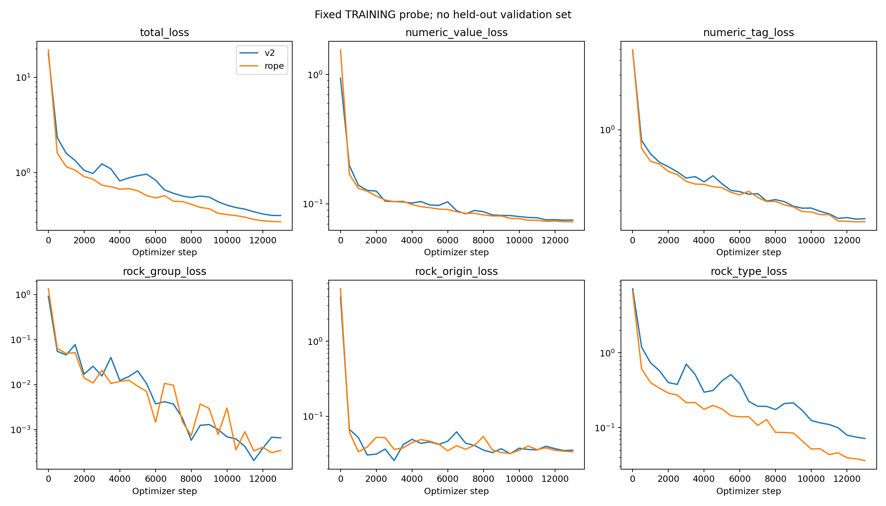
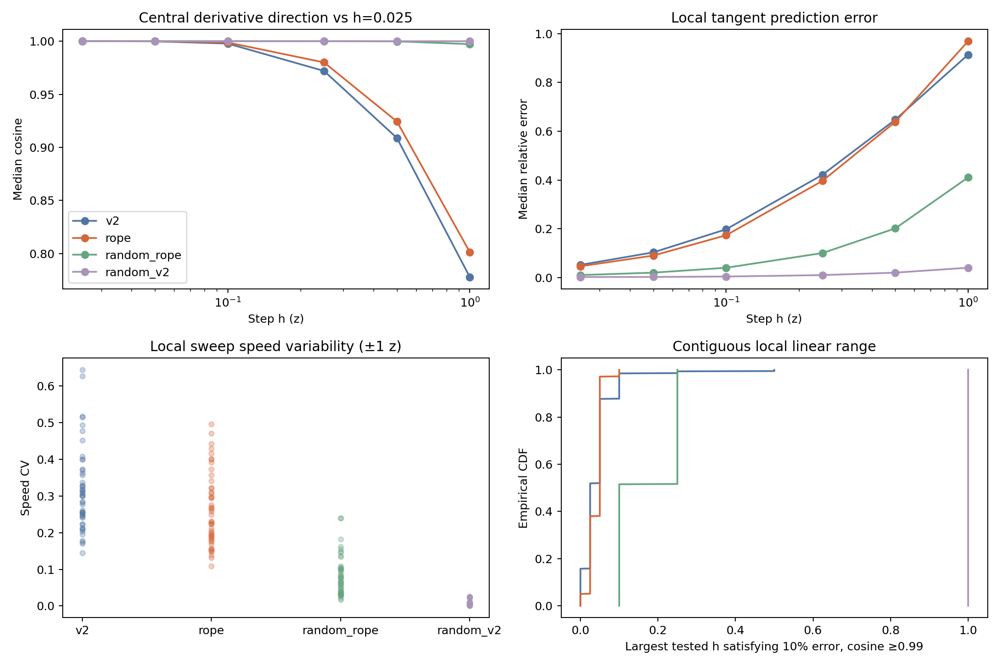
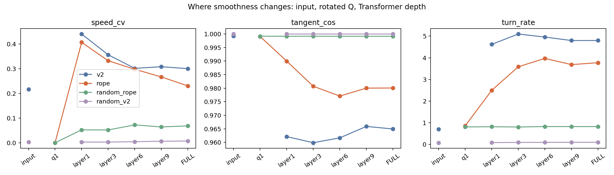
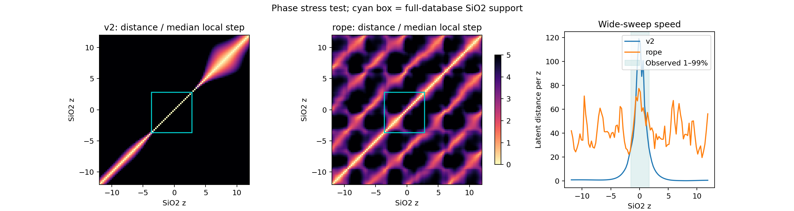
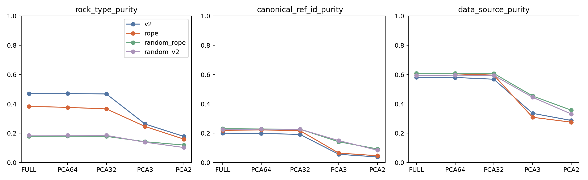
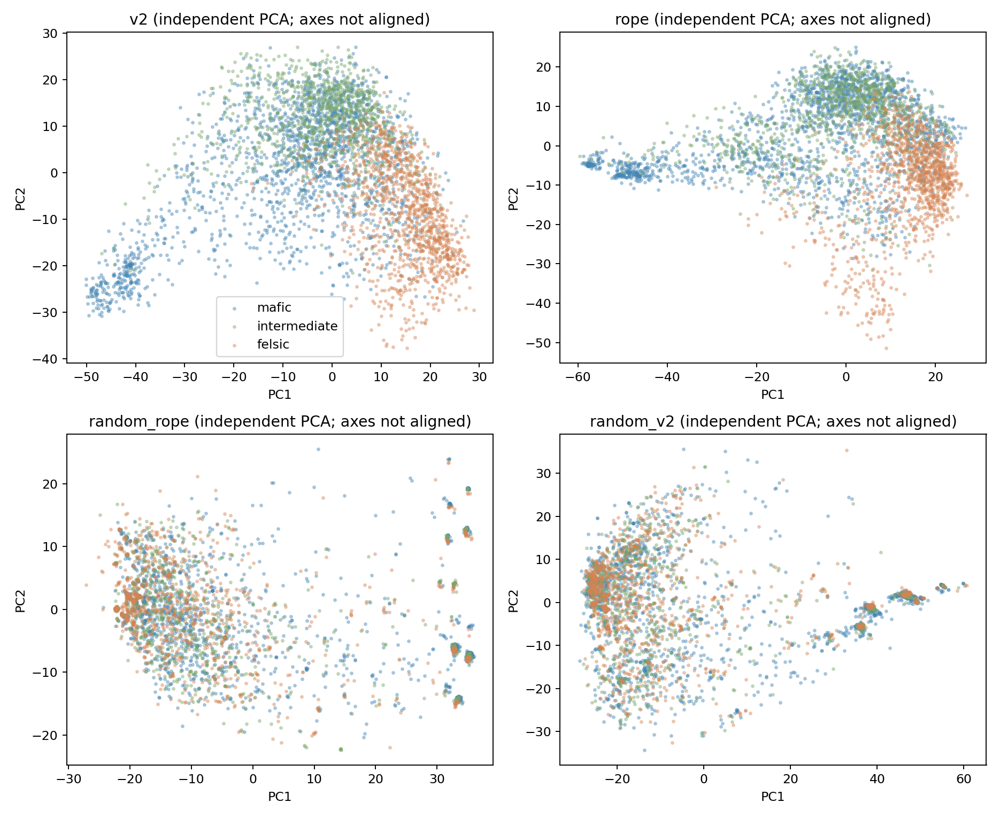

# Value RoPE Z：训练与 latent 配对审计

执行日期：2026-09-11 至 2026-09-12。实验分支：`experiment/value-rope-z`。基线：Stage 3.5 V2 50 epoch，起点提交 `5650034`。本报告覆盖本轮 11 项要求，原有 Stage 3.6 结果保持不变。

**结论：这个 checkpoint 改善了训练任务和部分局部几何，但没有改善整体地球化学表示质量，暂不应替代原 V2。**

- 固定训练 probe 总损失降低 14.5%；岩石类型预测改善，数值回归有好有坏。
- 在较小扰动下，RoPE 的切向方向更稳定，速度波动较小，联合扰动更接近单元素响应之和。
- 这些优势不延伸为统一、跨背景的元素方向，也不延伸为所有连续过程都更平滑。
- chemistry-only 的岩石近邻纯度下降 8.64 个百分点；文献和来源聚集上升。遮蔽标签、改用 CLS、PCA32/PCA64 都没有扭转这项下降。
- 随机 RoPE 和随机 MLP 都比训练后的模型更平滑。因此，平滑本身不是“学到地质语义”的证据。

## 1. 数据、模型和可比性

重新只读检查同一数据库视图，得到 270,241 条记录、34 个数值字段、81 个 rock-type 类别；有 rock-type 标签的记录为 252,506 条，缺失 17,735 条（6.56%）。另有 3 个 rock-group 和 9 个 origin 类别。

每样本平均有 21.80 个有效数值 token，中位数 24，范围 8–34。数据涉及 6,105 个文献引用、16 个来源和 24,989 种元素报告组合。缺失模式是重要变量。标准化后有 7,212 个数值 token 位于 ±12 截断边界，约占有效数值 token 的 0.12%。

岩石类别明显不均衡：subalkalic basalt 占 17.99%，granite 占 9.33%，basaltic andesite 占 6.93%。完整分类和数值覆盖统计见 `full_data_class_counts.csv`、`full_data_numeric_summary.csv`。

本轮模型均为 12 层、12 头、hidden 768、每头 64 维。原 V2 为 86,798,583 参数，RoPE 为 85,255,040 参数。除输入机制外，训练预算、任务比例和主要优化参数对齐；两个 checkpoint 均为 step 13,200。

**配对设计：**

| 项目 | 实际执行 |
|---|---|
| 全局 latent | 原 V2 缓存的同一批 12,000 样本 |
| PCA 拟合 / 评估 | 原有 8,000 / 4,000 样本 ID，二者不重叠 |
| 主输入 | chemistry-only，无岩石标签 token |
| 配套输入 | 同一 12,000 样本，所有已存在岩石标签使用 MASK ID |
| 表示 | 数值 token mean；另查 CLS；每种均为 768 维 |
| 模型对照 | 训练 V2、训练 RoPE、随机 RoPE、随机 V2；初始化 seed 42 |
| 数值 / 缺失基线 | V2 标准化 z（缺失补 0），34 维存在标记 |
| 主空间 | FULL、PCA64、PCA32、PCA3、PCA2 |
| 随机投影 | 每种维数 10 个正交投影，seed 1–10；每个 768 维表示共 45 个空间 |
| 局部样本 | 30 个真实样本，每背景 10 个，至少 20 个数值 token；另加 3 个完整中位数背景 |
| 有限差分 | 907 个样本–元素组合，h = 0.025、0.05、0.1、0.25、0.5、1 |
| 单元素 sweep | 6 个字段；49 条局部路径（中心 ±1，间隔 0.05），49 条宽路径（−12 到 12，间隔 0.25） |
| 固定值背景补测 | 相同元素均置 z=0，再测 ±0.005、±0.025、±0.1，共 6,349 个输入 |
| 主扰动集合 | 26,277 个输入；另有 390 个真实 log-concentration/ratio 输入 |
| 推理设备 | 本机 Element2Vec 环境，PyTorch 2.12.1，MPS；CPU 交叉核验 |

复用原词表和数值变换；12,000 个缓存样本重新变换与原保存 z 在 `1e-10` 容差内一致。原 V2 的本轮 latent 与旧 CPU 缓存的相对误差为 `5.0e-7`。四模型 CPU/MPS 对照误差为 `2.8e-7` 至 `7.1e-7`，不足以解释主要差异。

所有跨模型比较均比较各自空间内的标量指标，不直接对两个独立模型的坐标向量计算方向余弦。PCA 图各有自己的拟合基，坐标轴不能相互对齐解读。

## 2. 训练是否正常完成

两个训练日志均完整覆盖连续的 13,200 步、50 个名义 epoch，无缺失步、重复步或非有限损失；最终学习率均为 `3e-6`。有效 batch 为 1,024 的更新各有 13,150 次，每个 epoch 尾批为 929，共 50 次，与原训练行为一致。

最后 500 步总损失均值从 **0.36331 降到 0.28890**。代码中名为 `EMA500` 的字段实际是最近 500 步的算术移动平均，本轮没有改变它。

还在同一套重新生成的固定训练 probe 上，对两个**最终 step 13,200** 权重重测，避免仅比较日志中的 step 13,000：

| 指标 | V2 | RoPE |
|---|---:|---:|
| 总损失 | 0.35137 | **0.30026** |
| 数值 Huber | 0.07505 | **0.07230** |
| 元素标签 CE | 0.16851 | **0.15883** |
| Rock-group CE | 0.000481 | **0.000303** |
| Origin CE | 0.03534 | **0.03333** |
| Rock-type CE | 0.07198 | **0.03550** |
| 数值 MAE | 0.23246 | **0.22996** |
| 数值 RMSE | **0.5094** | 0.5161 |
| 数值 R² | **0.71320** | 0.70561 |
| 元素标签准确率 | 94.22% | **94.54%** |
| Rock-type 准确率 | 98.25% | **99.12%** |

数值回归子任务有 3,726 个样本，rock-type 子任务有 1,826 个样本。后者有 21 个样本从错变对、5 个从对变错。数值 Huber/MAE 略好而 RMSE/R² 略差，说明不能概括为“数值预测全面改善”。

**这是训练集诊断，不是独立验证。** 预训练使用完整数据和岩石标签；单任务掩码时其他标签可能可见。因此较好的 probe 不保证去掉标签后的 latent 邻域更好，也无法据此判断外部泛化或排除过拟合。

## 3. 小步长方向、速度与曲率

定义中心差分 `J_h = [f(z+h)−f(z−h)]/(2h)`；方向与 `J_0.025` 比较。局部预测误差为 `||f(z+h)−f(z)−h J_0.025|| / ||f(z+h)−f(z)||`。下表为真实样本–元素组合的中位数：

| h（z 单位） | V2 方向余弦 | RoPE 方向余弦 | V2 局部预测误差 | RoPE 局部预测误差 |
|---:|---:|---:|---:|---:|
| 0.05 | 0.99988 | **0.99994** | 0.1032 | **0.0902** |
| 0.10 | 0.99778 | **0.99880** | 0.1978 | **0.1734** |
| 0.25 | 0.97195 | **0.98001** | 0.4213 | **0.3962** |
| 0.50 | 0.90884 | **0.92434** | 0.6473 | 0.6380 |
| 1.00 | 0.77792 | **0.80143** | **0.9138** | 0.9689 |

以 30 个真实样本为重采样单元的配对 bootstrap：h=0.1 时方向余弦的平均差为 `+0.00437 [0.00321, 0.00567]`；局部预测误差平均差为 `−0.03363 [−0.04624, −0.02180]`。h≥0.5 时，局部预测误差改善的区间已经跨过 0。不能把小步长优势外推到大扰动。

固定元素 z=0，并改用 h=0.005 作更细参考后，h=0.025 的方向余弦中位数仍为 V2 0.99997、RoPE 0.99999；h=0.1 则为 0.99398、0.99805。主要结论不是单一参考步长造成的。

局部 ±1 z sweep 的整体中位数：

| 指标 | V2 | RoPE | 随机 RoPE | 随机 V2 |
|---|---:|---:|---:|---:|
| 速度 CV，低较好 | 0.3006 | **0.2305** | 0.0682 | 0.0067 |
| 相邻切向余弦，高较好 | 0.9650 | **0.9801** | 0.99916 | 0.99999 |
| 每单位 z 的转角，低较好 | 4.799 | **3.772** | 0.820 | 0.096 |

仅使用真实背景的局部 sweep，速度 CV 的配对平均差为 `−0.0558 [−0.1049, −0.0098]`；但这里只有 **6 个独立背景样本**，不能把 49 条路径当作 49 个独立样本。

**宽 sweep 不同：** RoPE 的速度更均匀，但切向方向反而更不稳定；真实背景的切向余弦配对平均差约 `−0.198`。均匀地沿着弯曲、反复折返的路径移动，并不等于更好的连续编码。所有网络本身都连续；这里比较的是给定尺度下的局部规则程度。

## 4. 局部稳定不等于跨背景方向一致

为避免把“当前元素值不同”误认为“上下文不同”，补测时将被扰动元素全部固定为 **z=0**，其他元素和报告面板保留，再计算 h=0.1 的方向。

| 同元素响应方向平均余弦 | V2 | RoPE | 随机 RoPE |
|---|---:|---:|---:|
| 真实样本，同一背景类内 | 0.4926 | 0.4384 | 0.6945 |
| 真实样本，不同背景类间 | 0.4026 | 0.3035 | 0.6497 |
| 三个完整中位数背景之间 | 0.4433 | 0.4023 | 0.9234 |

RoPE 的响应可以在一个样本附近更稳定，同时在不同背景中更加不同。结果**不支持统一、可跨 mafic/intermediate/felsic 直接搬用的元素方向**。自然样本还混有报告面板和文献差异；这些方向比较是描述性统计，样本对不是独立重复。

## 5. Common、single 和 ratio/contrast shift

先控制输入扰动的 z 向量 L2 范数，再将 latent 位移除以模型在 PCA 拟合样本上的 RMS 半径，减少模型整体尺度差异。以下是 h=0.1 的中位敏感度；各项有效背景数随元素是否存在而变，完整配对记录只保存在本地。

| 扰动 | V2 | RoPE |
|---|---:|---:|
| 所有可见数值 z 同方向平移（单位方向） | 0.9008 | **0.0154** |
| 单个 Rb 的 z 改变 | 0.1457 | 0.1262 |
| Rb/Sr 的 z 对比方向 | 0.1521 | **0.1998** |

RoPE 确实强烈抑制共同 z 平移。但真实浓度实验给出了限制：将全部可见微量元素乘同一个因子时，需分别按各元素的 log10/IQR 换算，不会成为相同的 z 位移。

在同一批 26 个 Rb/Sr 可用背景上，对实际 log10 浓度扰动的结果为：

| 真实浓度扰动，h=0.1 dex | V2 | RoPE |
|---|---:|---:|
| 所有可见微量元素同比例变化 | 0.1534 | 0.1554 |
| 只改变 Rb | 0.1444 | 0.1279 |
| Rb ×10^(h/2)，Sr ×10^(−h/2) | 0.1538 | **0.2117** |

因此，证据支持 **对标准化值的差异/对比更敏感**，不支持“对绝对浓度天然不敏感”或“已经学到组成不变性”。主量元素的 z 是线性浓度，微量元素的 z 又有不同 IQR，二者尤其不能混作统一的浓度比坐标。

作为机制对照，将包括 CLS 在内的所有 RoPE 位置共同加 1，完整输出相对误差仅 `4.65e-7`；正常只平移数值位置时，相对变化为 0.383（16 样本对照）。CLS 固定在 0 是一个绝对位置参照；正式模型并非严格平移不变。

## 6. 联合扰动与局部线性范围

重放 mafic、incompatible、compatible、weathering 四组联合扰动；仅在所需元素全部存在且不会截断时比较。下表为联合位移与单元素位移之和的相对残差中位数，包含真实及完整中位数背景：

| 单元素幅度 h | V2 | RoPE |
|---:|---:|---:|
| 0.025 | 0.0243 | **0.0187** |
| 0.10 | 0.0884 | **0.0677** |
| 0.25 | 0.1844 | **0.1503** |
| 0.50 | 0.2740 | **0.2408** |
| 1.00 | 0.4527 | **0.3407** |

RoPE 的可加性有所改善，但 h=1 时约 34% 的残差仍然很大。不能据此执行大幅度向量算术。

预先设定“局部预测误差 ≤10%，且方向余弦 ≥0.99”，要求从最小步长开始连续满足。真实样本的最大合格 h 中位数由 V2 **0.025** 增至 RoPE **0.05**；均值却由 0.0430 变为 0.0407，说明分布有交叉，不能声称所有元素的线性区间都扩大。0 表示低于本轮最小测试尺度，并非数学上不存在局部导数；1 是本轮上界。

三个完整背景的 34→768 Jacobian 中，解释 90% 响应能量需要 V2 5–6 个方向、RoPE 8–9 个方向。这是局部响应结构的差异，不是全局内在维数的证明。

## 7. 连续过程路径：均匀性和方向性需要分开

混合和部分熔融直接复用原实验保存的组成与参数网格；风化复现原公式及端点。原 E3 的“分异”是天然类别质心序列，本轮也重放；另外增加明确标记的 Rayleigh 微量元素代理路径，其主量固定、分配系数为粗略代理，不能当作真实岩浆模拟。

速度一律使用 `||Δlatent||/Δ参数`；部分熔融的 F 网格不均匀，不能直接用相邻距离代替速度。

| 过程 | V2 速度 CV | RoPE 速度 CV | V2 相邻方向余弦 | RoPE 相邻方向余弦 |
|---|---:|---:|---:|---:|
| 混合，8 条路径 | 0.2949 | **0.2225** | **0.8068** | 0.7120 |
| 部分熔融，4 条路径 | 0.6802 | **0.6060** | 0.9395 | **0.9445** |
| 风化，2 条路径 | **0.0736** | 0.1069 | **0.9921** | 0.9624 |
| Rayleigh 分异代理，1 条 | **0.5512** | 0.6075 | 0.9414 | **0.9556** |

混合路径位移更均匀，但转向更强；风化两项都退步；分异速度均匀性和方向平滑性给出相反判断。不存在“所有地质过程都更连续”的结果。原始 z 和随机模型也能形成平滑路径；这些共享端点的少量代理路径没有独立自然套系验证。

## 8. 连续旋转如何穿过 Transformer

以下为局部 sweep 的中位数。输入是标签 embedding；Q/K 指第一层被扰动 token 的旋转投影；后续层指有效数值 token mean。

| RoPE 表示位置 | 速度 CV | 相邻方向余弦 | 每 z 转角 |
|---|---:|---:|---:|
| 标签输入 | 不适用：没有数值位移 | 不适用 | 不适用 |
| 第一层旋转 Q | ≈0 | 0.9991 | 0.8584 |
| 第 1 层输出 | 0.4074 | 0.9900 | 2.4988 |
| 第 3 层输出 | 0.3325 | 0.9807 | 3.5857 |
| 第 6 层输出 | 0.2981 | 0.9771 | 3.9722 |
| 第 9 层输出 | 0.2670 | 0.9800 | 3.6857 |
| 第 12 层输出 | 0.2305 | 0.9801 | 3.7721 |

Q/K 旋转的匀速性质在注意力加权后已经被改变；深层缓解了一部分速度波动，没有恢复最初的旋转几何。恒定标签输入不能被评分为“完美平滑”，所以相关指标明确记为不适用。

六个 sweep 元素中，训练后第一层 Q/K 在最高频旋转对上的平均能量占比分别为 **26.4% / 25.2%**，随机 RoPE 为 **3.0% / 3.7%**。这是训练强化高频数值通道的直接观察，与宽 sweep 中的周期性结构相符，但不单独构成因果归因。

## 9. Phase wrapping 与 distant collision

单个最快旋转对的周期约为 2π，但整个 64 维头包含 32 个频率；不是完整向量每隔 2π 就重复。均匀频率权重下，相隔 2π 的平均旋转相似度约为 0.7355，不能把它当作精确重合。

预先使用以下近碰撞定义：同一宽 sweep 中 `|Δz|≥4`，但 latent 距离小于该路径 **0.25 z 相邻步位移的中位数**。

- 在 −12 到 12 的 49 条宽路径中，训练 RoPE 的最终 mean 有 **4 条路径、5 对取值**触发近碰撞，均为 SiO₂；V2 和两个随机对照未触发。最小距离比约 0.955。它们是相对近碰撞，不是数值相等。
- 例如 intermediate 中位数背景的 z=−0.5 和 5.75 相近；后一值超出全数据库 SiO₂ 的实际范围。宽扫描还会产生负浓度或超过 100 wt% 的主量值，因此属于外推压力测试。
- 限制到各元素在**完整数据库中观测到的 z 范围**后，每模型共 15,105 对合格远距离候选，均未触发上述阈值；RoPE 最小距离比为 1.79，V2 为 3.79。1–99% 范围的候选更少，只有 135 对，不能夸大阴性结果。
- 预处理的 ±12 截断会把更极端的不同原始值映射为同一个 z，这是两个模型共有的确定性信息损失，应与 RoPE 相位近碰撞分开。

这轮发现的是**宽范围周期折返和外推风险**；没有证据说明当前常见数据范围内普遍发生周期碰撞，也不能保证未测试元素/背景/联合路径完全没有碰撞。

## 10. 固定元素值的 contextual background probe

对 Ni、Sr、Zr、Rb、K₂O、CaO 各取 300 个背景（每背景 100），固定查询元素 z=0；从其最终 contextual token 预测 mafic/intermediate/felsic。所有模型用相同样本和折分；StandardScaler、PCA16、分类器均只在每折训练部分拟合。

| 六元素平均 balanced accuracy | V2 | RoPE | 随机 RoPE | 随机 V2 |
|---|---:|---:|---:|---:|
| 分层五折 | 91.83% | 91.06% | 44.39% | 50.17% |
| 按 reference 分组五折 | 92.27% | 91.33% | 41.52% | 48.38% |

强上下文读出能力保留了，但这不是等效性检验。元素间有差别：分组 probe 的 Ni 从 95.67% 降到 89.00%，Zr 从 89.56% 升到 93.67%。不能把平均值接近概括为每个元素都无损。

背景类别由 SiO₂ 阈值定义；直接读取原始 SiO₂ 原本就能恢复这些类别。该实验只能证明固定值 token 汇入了上下文信息，不能证明新增地学知识。分组只约束 probe，不能消除预训练已经见过这些记录/文献的问题。

## 11. 整体表示质量守门指标

以下为同一 4,000 样本评估池、cosine k=15，排除自身；缺失标签不当作同一个真实类别。kNN 是该池内的 leave-one-out 读出，不是独立预训练测试集。

| FULL 指标 | V2 | RoPE |
|---|---:|---:|
| Chemistry-only 岩石近邻纯度 | **46.98%** | 38.35% |
| Chemistry-only kNN accuracy | **60.83%** | 50.91% |
| Chemistry-only kNN balanced accuracy | **34.07%** | 23.94% |
| 全标签遮蔽，岩石近邻纯度 | **47.34%** | 41.92% |
| 全标签遮蔽，kNN accuracy | **61.10%** | 55.12% |
| CLS chemistry-only，岩石近邻纯度 | **45.11%** | 39.00% |
| 文献引用近邻纯度 | **20.05%** | 21.94% |
| 数据来源近邻纯度 | **58.12%** | 60.63% |

以 reference 为簇的配对 bootstrap，RoPE−V2 的岩石近邻纯度差为 **−8.64 pp，95% 区间 [−9.25, −7.99] pp**；文献纯度差为 **+1.89 pp [0.68, 3.26]**；来源纯度差为 **+2.51 pp [1.20, 3.93]**。这是本轮最明确的负面结果。

PCA32/PCA64 和十种随机投影控制没有扭转该结论。RoPE 的前三 PC 方差占比由 V2 的 26.47% 升到 31.03%，但 PC1 与 token 数的相关绝对值由 0.575 升到 0.622，PC2 则由 0.217 升到 0.558。方差更集中不能直接解释为地质结构更清楚。

缺失鲁棒性用相同 400 个评估样本、相同删除掩码。25% 随机 token 删除后，原/扰动向量余弦中位数 RoPE 略高（0.392 vs 0.367），但 kNN accuracy 只有 **14.50%**，V2 为 **25.45%**；无删除时这个子集分别为 40.20% 和 52.93%。因此余弦保持稍好也不能概括成语义鲁棒性更好。

去掉全部微量元素的面板测试，两模型的该子集 kNN 反而略升；这一面板与随机删除效果不同，提醒我们部分报告模式/微量字段可能增加混杂。这不是“微量元素没有地质价值”的证据，也不是可按结果优化的面板选择。

## 12. 随机对照与实验判断

随机模型都非常平滑，却有很差的岩石邻域（随机 RoPE 17.89%，随机 V2 18.69%），且对报告面板极为敏感。训练后 RoPE 的 38.35% 明显超过随机及原始 z 的 31.23%，说明训练确实增加了结构；但原 V2 的 46.98% 更好。

最符合本轮结果的解释是：**RoPE 引入了强的标准化值相对响应偏置，训练又强化了部分高频旋转通道；它改善了局部数值扰动的某些指标，却未把这项优势转化为更好的整体岩石表示。** 这是对这两个固定 checkpoint 的解释，尚不是多训练种子下的架构普遍结论。

建议保留本分支作为有价值的补充/负面对照。后续优先检验绝对数值参照与训练读出目标是否不足，并把 chemistry-only 邻域和来源混杂列为训练方案的守门项；先不要仅凭 probe 或整体 straightness 扩大训练预算。任何新架构修改应另开对照，不改写本轮结果。

## 13. 覆盖、验证与复现

11 项要求均有实际结果，索引见 `experiment_registry.csv`。原 50 项 Stage 3.6 没有全部重跑；本轮重放请求涉及的连续过程和整体守门指标，并补充相位、层级、固定值背景、真实 ratio 和随机对照。

- 四模型主/遮蔽 latent 均为每种 12,000×768，并保存在本地被忽略的 audit 目录；这不是整库 270,241 行的 latent 导出。
- 样本 ID、扰动输入、逐样本预测、PCA 基、latent 数组和机器/数据指纹只留在本地；此目录仅发布汇总表、报告和栅格图。
- 原 V2 缓存复核、CPU/MPS 复核、非有限值检查、12 项模型测试、6 项分析指标测试和公开树审计通过。完整数组核验见 `final_verification.json`。全部训练 checkpoint 保持在忽略目录。
- 有限差分、sweep 和 probe 的置信区间描述这些固定模型及选定样本的不确定性；只有一个训练/随机初始化种子，不能代替独立重训重复。过程路径少且共享端点；多指标属于探索性比较，没有做全家族多重检验校正。

运行步骤见 [REPRODUCE.md](REPRODUCE.md)。表格中缺失值表示数学上不适用（如恒定输入的切向方向），不代表指标为零或“完美连续”。
